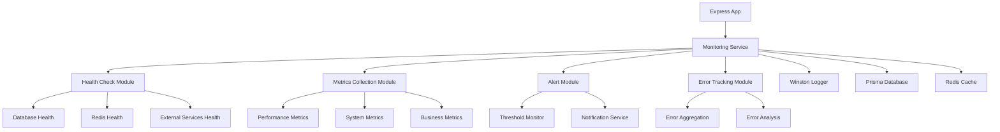

# Design Document

## Overview

監控服務將作為一個獨立的服務模組整合到現有的 TypeScript 應用程式中。該服務將提供系統健康檢查、性能指標收集、錯誤追蹤和警報功能。設計遵循現有專案的架構模式，使用 TypeScript、Express.js、Prisma 和 Winston 日誌系統。

## Architecture

### 系統架構圖



### 服務層級架構

監控服務將按照現有專案的分層架構設計：

1. **Routes Layer** (`src/routes/monitoring.routes.ts`)
   - 提供 REST API 端點
   - 處理 HTTP 請求和回應

2. **Controller Layer** (`src/controllers/monitoring.controller.ts`)
   - 處理業務邏輯協調
   - 驗證請求參數

3. **Service Layer** (`src/services/monitoring/`)
   - 核心業務邏輯實現
   - 與外部系統整合

4. **Types Layer** (`src/types/monitoring.types.ts`)
   - TypeScript 類型定義
   - 介面和資料模型

## Components and Interfaces

### 1. Health Check Module

**Purpose**: 檢查系統各組件的健康狀態

**Components**:
- `HealthCheckService`: 主要健康檢查服務
- `DatabaseHealthChecker`: 資料庫連線檢查
- `RedisHealthChecker`: Redis 連線檢查
- `ExternalServiceHealthChecker`: 外部服務檢查

**Interfaces**:
```typescript
interface HealthCheckResult {
  status: 'healthy' | 'unhealthy' | 'degraded';
  component: string;
  timestamp: Date;
  responseTime?: number;
  details?: Record<string, unknown>;
  error?: string;
}

interface SystemHealthStatus {
  overall: 'healthy' | 'unhealthy' | 'degraded';
  components: HealthCheckResult[];
  uptime: number;
  timestamp: Date;
}
```

### 2. Metrics Collection Module

**Purpose**: 收集和儲存系統性能指標

**Components**:
- `MetricsCollectionService`: 指標收集協調器
- `PerformanceMetricsCollector`: 應用程式性能指標
- `SystemMetricsCollector`: 系統資源指標
- `BusinessMetricsCollector`: 業務邏輯指標

**Interfaces**:
```typescript
interface MetricData {
  name: string;
  value: number;
  unit: string;
  timestamp: Date;
  tags?: Record<string, string>;
  metadata?: Record<string, unknown>;
}

interface PerformanceMetrics {
  responseTime: MetricData;
  requestCount: MetricData;
  errorRate: MetricData;
  throughput: MetricData;
}

interface SystemMetrics {
  cpuUsage: MetricData;
  memoryUsage: MetricData;
  diskUsage: MetricData;
  networkIO: MetricData;
}
```

### 3. Alert Module

**Purpose**: 監控閾值並發送警報

**Components**:
- `AlertService`: 警報管理服務
- `ThresholdMonitor`: 閾值監控器
- `NotificationService`: 通知發送服務

**Interfaces**:
```typescript
interface AlertRule {
  id: string;
  name: string;
  metric: string;
  condition: 'greater_than' | 'less_than' | 'equals';
  threshold: number;
  duration: number; // seconds
  severity: 'low' | 'medium' | 'high' | 'critical';
  enabled: boolean;
}

interface Alert {
  id: string;
  ruleId: string;
  message: string;
  severity: 'low' | 'medium' | 'high' | 'critical';
  timestamp: Date;
  resolved: boolean;
  resolvedAt?: Date;
  metadata?: Record<string, unknown>;
}
```

### 4. Error Tracking Module

**Purpose**: 追蹤和分析應用程式錯誤

**Components**:
- `ErrorTrackingService`: 錯誤追蹤服務
- `ErrorAggregator`: 錯誤聚合器
- `ErrorAnalyzer`: 錯誤分析器

**Interfaces**:
```typescript
interface ErrorEvent {
  id: string;
  message: string;
  stack?: string;
  level: 'error' | 'warning';
  timestamp: Date;
  context?: Record<string, unknown>;
  userId?: string;
  requestId?: string;
  fingerprint: string; // for grouping similar errors
}

interface ErrorSummary {
  fingerprint: string;
  message: string;
  count: number;
  firstSeen: Date;
  lastSeen: Date;
  level: 'error' | 'warning';
  trend: 'increasing' | 'decreasing' | 'stable';
}
```

## Data Models

### 監控資料儲存策略

1. **即時資料**: 使用 Redis 儲存最近的指標和狀態
2. **歷史資料**: 使用 PostgreSQL (Prisma) 儲存長期資料
3. **日誌資料**: 使用現有的 Winston 日誌系統

### Prisma Schema 擴展

```prisma
model MonitoringMetric {
  id        String   @id @default(cuid())
  name      String
  value     Float
  unit      String
  timestamp DateTime @default(now())
  tags      Json?
  metadata  Json?
  
  @@map("monitoring_metrics")
}

model MonitoringAlert {
  id         String   @id @default(cuid())
  ruleId     String
  message    String
  severity   String
  timestamp  DateTime @default(now())
  resolved   Boolean  @default(false)
  resolvedAt DateTime?
  metadata   Json?
  
  @@map("monitoring_alerts")
}

model MonitoringError {
  id          String   @id @default(cuid())
  message     String
  stack       String?
  level       String
  timestamp   DateTime @default(now())
  context     Json?
  userId      String?
  requestId   String?
  fingerprint String
  
  @@map("monitoring_errors")
}
```

## Error Handling

### 錯誤處理策略

1. **監控服務錯誤不應影響主應用程式**
   - 使用 try-catch 包裝所有監控操作
   - 監控失敗時記錄日誌但不拋出異常

2. **優雅降級**
   - 當資料庫不可用時，使用記憶體暫存
   - 當 Redis 不可用時，跳過快取操作

3. **錯誤分類**
   - **Critical**: 影響主要功能的錯誤
   - **Warning**: 可能影響性能的問題
   - **Info**: 一般性資訊

### 錯誤處理實現

```typescript
class MonitoringErrorHandler {
  static async safeExecute<T>(
    operation: () => Promise<T>,
    fallback?: T,
    context?: string
  ): Promise<T | undefined> {
    try {
      return await operation();
    } catch (error) {
      logger.warn(`Monitoring operation failed: ${context}`, {
        error: error.message,
        stack: error.stack
      });
      return fallback;
    }
  }
}
```

## Testing Strategy

### 測試層級

1. **單元測試**
   - 測試各個服務類別的方法
   - 模擬外部依賴（資料庫、Redis）
   - 測試錯誤處理邏輯

2. **整合測試**
   - 測試監控服務與資料庫的整合
   - 測試 API 端點的完整流程
   - 測試警報觸發機制

3. **端到端測試**
   - 測試完整的監控工作流程
   - 測試監控資料的收集和查詢
   - 測試系統在高負載下的表現

### 測試工具和框架

- **Jest**: 主要測試框架
- **Supertest**: API 端點測試
- **jest-mock-extended**: 模擬外部依賴
- **@faker-js/faker**: 生成測試資料

### 測試資料管理

```typescript
// 測試資料工廠
class MonitoringTestDataFactory {
  static createHealthCheckResult(): HealthCheckResult {
    return {
      status: 'healthy',
      component: 'database',
      timestamp: new Date(),
      responseTime: 50
    };
  }

  static createMetricData(): MetricData {
    return {
      name: 'response_time',
      value: 150,
      unit: 'ms',
      timestamp: new Date()
    };
  }
}
```

## Performance Considerations

### 性能優化策略

1. **非同步處理**
   - 使用非同步方法避免阻塞主執行緒
   - 批次處理指標資料以減少資料庫寫入

2. **快取策略**
   - 使用 Redis 快取頻繁查詢的監控資料
   - 實現智慧快取失效機制

3. **資料聚合**
   - 定期聚合歷史資料以減少儲存空間
   - 實現資料保留政策

4. **採樣策略**
   - 對高頻率指標實施採樣以減少資料量
   - 根據重要性調整採樣率

### 資源使用監控

```typescript
class ResourceMonitor {
  private static readonly MAX_MEMORY_USAGE = 0.8; // 80%
  private static readonly MAX_CPU_USAGE = 0.9; // 90%

  static async checkResourceUsage(): Promise<void> {
    const usage = await this.getSystemUsage();
    
    if (usage.memory > this.MAX_MEMORY_USAGE) {
      logger.warn('High memory usage detected', { usage: usage.memory });
    }
    
    if (usage.cpu > this.MAX_CPU_USAGE) {
      logger.warn('High CPU usage detected', { usage: usage.cpu });
    }
  }
}
```

## Integration Points

### 與現有系統的整合

1. **Winston 日誌系統**
   - 使用現有的 `loggerService` 記錄監控事件
   - 擴展日誌格式以包含監控特定資訊

2. **Express 中間件**
   - 整合到現有的中間件鏈中
   - 收集 HTTP 請求指標

3. **Prisma 資料庫**
   - 擴展現有的資料庫 schema
   - 使用現有的資料庫連線池

4. **Redis 快取**
   - 使用現有的 Redis 連線
   - 實現監控資料的快取層

### API 端點設計

```typescript
// 監控 API 端點
GET /api/v1/monitoring/health        // 系統健康檢查
GET /api/v1/monitoring/metrics       // 獲取指標資料
GET /api/v1/monitoring/alerts        // 獲取警報列表
POST /api/v1/monitoring/alerts       // 創建警報規則
GET /api/v1/monitoring/errors        // 獲取錯誤統計
GET /api/v1/monitoring/dashboard     // 監控儀表板資料
```

## Security Considerations

### 安全措施

1. **存取控制**
   - 監控端點需要適當的認證
   - 實施角色基礎的存取控制

2. **資料保護**
   - 敏感資料在日誌中進行遮罩處理
   - 實施資料保留和清理政策

3. **API 安全**
   - 實施速率限制防止濫用
   - 驗證和清理所有輸入資料

4. **監控資料完整性**
   - 實施資料驗證確保指標準確性
   - 防止監控資料被惡意修改