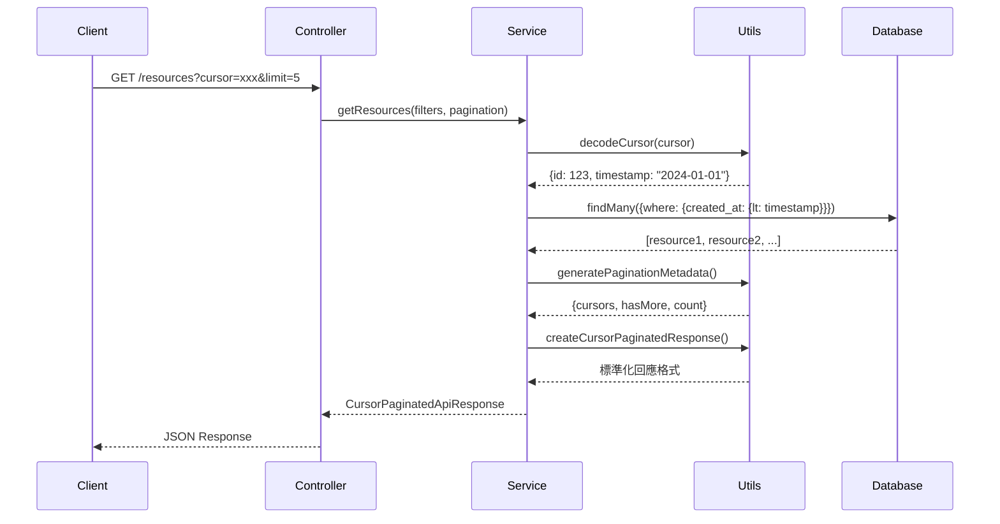
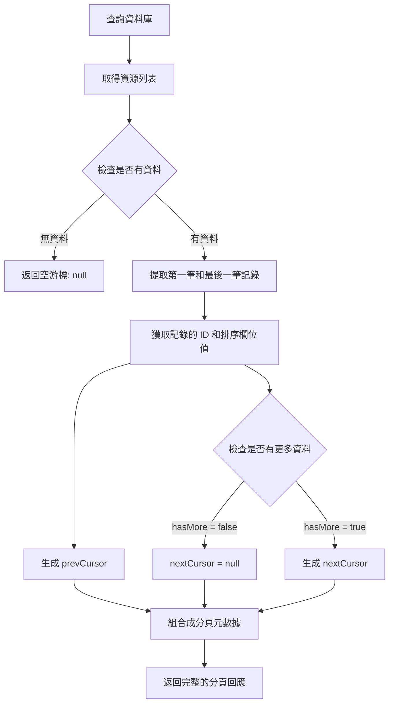

# Cursor 分頁實現指南

## 概述

本文件說明 DaoDao Server 中 `src/services/resource.service.ts` 實現的 cursor 分頁機制。Cursor 分頁是一種高效的分頁方式，特別適合大數據集和實時變化的數據。

## 什麼是 Cursor 分頁？

Cursor 分頁使用加密的游標（cursor）來標識分頁位置，相比傳統的 offset 分頁，具有以下優勢：

- **性能優異**：避免 OFFSET 導致的性能問題
- **一致性**：新增數據不會影響分頁結果
- **精確定位**：使用唯一標識符精確定位
- **擴展性好**：適合大數據集分頁

## 技術架構

### 核心組件

```
資源分頁系統
├── Controller Layer (resource.controller.ts)
│   ├── 處理 HTTP 請求參數
│   ├── 調用 Service 層
│   └── 返回統一格式回應
├── Service Layer (resource.service.ts) 
│   ├── 實現分頁業務邏輯
│   ├── 構建資料庫查詢條件
│   └── 處理游標編碼/解碼
├── Utils Layer (transform-utils.ts)
│   ├── 游標編碼和解碼函數
│   ├── 分頁元數據生成
│   └── 資料轉換工具
└── Database Layer (Prisma ORM)
    ├── 執行 SQL 查詢
    ├── 處理關聯查詢
    └── 返回結構化數據
```

### 資料流程



## 實現細節

### 1. 游標結構設計

游標採用 Base64 編碼的 JSON 格式：

```typescript
// 游標內容結構
interface CursorData {
  id: number;           // 記錄的唯一 ID
  timestamp: Date;      // 排序欄位的值（通常是 created_at）
}

// 範例：
const cursorData = { id: 123, timestamp: "2024-01-01T10:00:00Z" };
const encodedCursor = Buffer.from(JSON.stringify(cursorData)).toString('base64');
// 結果：eyJpZCI6MTIzLCJ0aW1lc3RhbXAiOiIyMDI0LTAxLTAxVDEwOjAwOjAwWiJ9
```

#### Cursor 產生的完整流程



#### 實際產生程式碼

```typescript
// 1. 核心產生函數 (transform-utils.ts)
export function generateCursor(id: number, timestamp: string | number | Date): string {
  // 創建游標數據對象
  const cursorData = { id, timestamp };
  
  // 轉換為 JSON 並編碼為 BASE64
  return Buffer.from(JSON.stringify(cursorData)).toString('base64');
}

// 2. 在分頁元數據生成中的使用 (transform-utils.ts)
export function generatePaginationMetadata(rows, count, limit, sortField, hasMore) {
  if (rows.length === 0) {
    return { cursors: { start: null, end: null }, hasMore: false, ... };
  }
  
  // 獲取第一條和最後一條記錄
  const firstItem = rows[0];
  const lastItem = rows[rows.length - 1];
  
  // 取得記錄的 ID 和排序欄位值
  const firstId = getFieldValue(firstItem, 'id') as number;
  const firstTimestamp = getFieldValue(firstItem, sortField);
  const lastId = getFieldValue(lastItem, 'id') as number;
  const lastTimestamp = getFieldValue(lastItem, sortField);
  
  // 生成游標
  const nextCursor = hasMore ? generateCursor(lastId, lastTimestamp) : null;
  const prevCursor = generateCursor(firstId, firstTimestamp);
  
  return {
    cursors: { start: prevCursor, end: nextCursor },
    hasMore,
    nextCursor,
    prevCursor,
    ...
  };
}

// 3. 在 Resource Service 中的調用 (resource.service.ts)
const paginationMetadata = generatePaginationMetadata(
  resourcesData,        // 查詢結果（已去除多餘的一筆）
  resourcesData.length, // 當前返回的數量
  actualLimit,          // 每頁限制
  sort,                // 排序欄位 (通常是 'created_at')
  hasMore              // 是否還有更多資料
);
```

#### 詳細產生步驟

1. **資料查詢階段**

   ```typescript
   // 查詢時多取一筆來判斷是否有下一頁
   const resources = await prisma.resources.findMany({
     // ... 查詢條件
     take: actualLimit + 1  // 假設 limit=5，實際查詢 6 筆
   });
   ```

2. **判斷是否有更多資料**

   ```typescript
   const hasMore = resources.length > actualLimit;  // 6 > 5 = true
   const resourcesData = hasMore ? resources.slice(0, actualLimit) : resources;  // 取前 5 筆
   ```

3. **提取關鍵資訊**

   ```typescript
   // 從第一筆記錄提取
   const firstResource = resourcesData[0];
   const firstId = firstResource.id;          // 例如：123 (數字 ID，非 UUID)
   const firstTimestamp = firstResource.created_at;  // 例如：2024-01-01T10:00:00Z
   
   // 從最後一筆記錄提取
   const lastResource = resourcesData[4];  // 第 5 筆（index 4）
   const lastId = lastResource.id;         // 例如：119 (數字 ID，非 UUID)
   const lastTimestamp = lastResource.created_at;   // 例如：2024-01-01T09:45:00Z
   ```

4. **產生游標字串**

   ```typescript
   // 生成 prevCursor (指向目前頁面的開始)
   const prevCursorData = { id: 123, timestamp: "2024-01-01T10:00:00Z" };
   const prevCursor = Buffer.from(JSON.stringify(prevCursorData)).toString('base64');
   // 結果：eyJpZCI6MTIzLCJ0aW1lc3RhbXAiOiIyMDI0LTAxLTAxVDEwOjAwOjAwWiJ9
   
   // 生成 nextCursor (指向下一頁的開始位置)
   if (hasMore) {
     const nextCursorData = { id: 119, timestamp: "2024-01-01T09:45:00Z" };
     const nextCursor = Buffer.from(JSON.stringify(nextCursorData)).toString('base64');
     // 結果：eyJpZCI6MTE5LCJ0aW1lc3RhbXAiOiIyMDI0LTAxLTAxVDA5OjQ1OjAwWiJ9
   } else {
     const nextCursor = null;  // 沒有下一頁
   }
   ```

#### 實際範例解析

**情境：獲取前 5 筆資源，按 created_at 降序排列**

**資料庫查詢結果（6 筆）：**

```
ID  | external_id | created_at           | name
123 | uuid-123   | 2024-01-01T10:00:00Z | React 教學
122 | uuid-122   | 2024-01-01T09:55:00Z | Vue 指南  
121 | uuid-121   | 2024-01-01T09:50:00Z | Angular 基礎
120 | uuid-120   | 2024-01-01T09:48:00Z | JavaScript 進階
119 | uuid-119   | 2024-01-01T09:45:00Z | CSS 技巧
118 | uuid-118   | 2024-01-01T09:40:00Z | HTML 結構    ← 第6筆，用於判斷hasMore
```

**處理步驟：**

1. `hasMore = true` (因為查到 6 筆)
2. `resourcesData` = 前 5 筆 (ID: 123, 122, 121, 120, 119)
3. 生成游標：
   - `prevCursor`: `{id: 123, timestamp: "2024-01-01T10:00:00Z"}` → Base64
   - `nextCursor`: `{id: 119, timestamp: "2024-01-01T09:45:00Z"}` → Base64

**最終回應：**

```json
{
  "success": true,
  "data": [/* 5 筆資源 */],
  "pagination": {
    "cursors": {
      "start": "eyJpZCI6MTIzLCJ0aW1lc3RhbXAiOiIyMDI0LTAxLTAxVDEwOjAwOjAwWiJ9",
      "end": "eyJpZCI6MTE5LCJ0aW1lc3RhbXAiOiIyMDI0LTAxLTAxVDA5OjQ1OjAwWiJ9"
    },
    "hasMore": true,
    "count": 5
  }
}
```

**下一頁請求：**

```http
GET /api/resources?cursor=eyJpZCI6MTE5LCJ0aW1lc3RhbXAiOiIyMDI0LTAxLTAxVDA5OjQ1OjAwWiJ9&limit=5
```

**下一頁查詢條件：**

```typescript
// 解碼游標
const decodedCursor = { id: 119, timestamp: "2024-01-01T09:45:00Z" };

// 生成查詢條件（降序，所以用 lt 查詢更早的記錄）
where.created_at = { lt: new Date("2024-01-01T09:45:00Z") };

// 這樣會查詢到 created_at < 2024-01-01T09:45:00Z 的記錄
// 即 ID 118 及更早的記錄
```

#### ID 來源解析

**重要：Cursor 中的 ID 是什麼？**

在我們的系統中，cursor 使用的是**資料庫的內部數字 ID**，而不是對外的 UUID：

```typescript
// 資料庫結構 (resources 表)
model resources {
  id          Int     @id @default(autoincrement())  // ← 這個是用於 cursor 的 ID  
  external_id String? @unique @default(dbgenerated("gen_random_uuid()")) @db.Uuid  // ← 這個是對外 API 的 ID
  name        String
  created_at  DateTime?
  // ...
}
```

**ID 的使用分工：**

| 用途 | ID 類型 | 範例 | 使用場景 |
|------|---------|------|----------|
| **Cursor 分頁** | 內部數字 ID (`id`) | 123, 119, 118... | 游標編碼、資料庫查詢、關聯表操作 |
| **對外 API** | 外部 UUID (`external_id`) | `a1b2c3d4-e5f6-...` | API 端點、前端顯示、公開引用 |

**為什麼使用內部 ID？**

1. **性能優勢**：整數比較和索引比 UUID 快很多
2. **空間效率**：整數只需 4 bytes，UUID 需要 36 bytes
3. **順序性**：自增 ID 天然有序，適合分頁
4. **關聯查詢**：資料庫外鍵關聯使用整數 ID

**實際查詢過程：**

```typescript
// 1. 從資料庫查詢時，同時取得兩種 ID
const resources = await prisma.resources.findMany({
  select: {
    id: true,           // 內部 ID：用於 cursor
    external_id: true,  // 外部 ID：用於 API 回應
    name: true,
    created_at: true,
    // ...
  }
});

// 2. 生成 cursor 時使用內部 ID
const cursor = generateCursor(resource.id, resource.created_at);
// cursor 內容：{ id: 123, timestamp: "2024-01-01T10:00:00Z" }

// 3. API 回應時轉換為外部 ID
const apiResponse = resources.map(resource => ({
  id: resource.external_id,  // 對外使用 UUID
  name: resource.name,
  // ...
}));
```

**標籤關聯的 ID 使用：**

```typescript
// entity_tags 表儲存的是內部數字 ID
// 因為關聯表需要高效的查詢性能
const tagQuery = await prisma.$queryRaw`
  SELECT * FROM entity_tags 
  WHERE entity_type = 'resource'
  AND entity_id::integer = ANY(${resourceIds}::integer[])  -- 使用內部 ID 陣列
`;

// resourceIds 範例：[123, 122, 121, 120, 119]
// 而不是 UUID 陣列
```

**重要提醒：**

- 前端永遠不會看到內部數字 ID
- Cursor 雖然包含內部 ID，但已經 Base64 編碼，前端無法直接解讀
- 所有 API 回應都使用 external_id (UUID)
- 只有在 cursor 分頁的內部邏輯中才使用數字 ID

### 2. 分頁參數處理

```typescript
// 分頁參數介面
interface PaginationParams {
  cursor?: string;           // 游標字符串
  limit?: number;           // 每頁數量（預設 5，最大 20）
  sort?: string;            // 排序欄位（預設 created_at）
  order?: 'asc' | 'desc';   // 排序方向（預設 desc）
}

// 實際使用
const { cursor, limit = DEFAULT_RESOURCE_PAGE_LIMIT, sort = 'created_at', order = 'desc' } = pagination;
const actualLimit = Math.min(limit, MAX_RESOURCE_PAGE_LIMIT); // 限制最大值
```

### 3. 資料庫查詢構建

#### 基礎查詢條件

```typescript
// 基礎篩選條件
const where: Prisma.resourcesWhereInput = {
  deleted_at: null  // 排除軟刪除的記錄
};

// 添加篩選條件
if (filters.type) where.type = filters.type;
if (filters.cost) where.cost = filters.cost;
if (filters.level) where.level = filters.level;
if (filters.status) where.status = filters.status;
if (filters.createdBy) where.created_by = filters.createdBy;
```

#### Cursor 條件處理

```typescript
// 處理游標分頁
if (cursor) {
  const decodedCursor = decodeCursor(cursor);
  if (sort === 'created_at' && decodedCursor) {
    // 根據排序方向設定時間範圍
    where.created_at = order === 'desc' 
      ? { lt: decodedCursor.timestamp }   // 獲取更早的記錄
      : { gt: decodedCursor.timestamp };  // 獲取更晚的記錄
  }
}
```

#### 關聯查詢

```typescript
const resources = await prisma.resources.findMany({
  where,
  include: {
    // 關聯作者資訊
    users: {
      select: {
        id: true,
        nickname: true,
        contacts: { select: { photo_url: true } }
      }
    },
    // 關聯主分類
    categories_resources_major_category_idTocategories: {
      select: { id: true, name: true }
    },
    // 關聯子分類
    categories_resources_sub_category_idTocategories: {
      select: { id: true, name: true }
    }
  },
  orderBy: { [sort]: order },
  take: actualLimit + 1  // 多取一個用於判斷是否有下一頁
});
```

### 4. 標籤處理（特殊邏輯）

由於標籤存儲在獨立的關聯表中，需要特殊處理：

```typescript
// 預先處理標籤篩選
let tagFilteredResourceIds: number[] | undefined;
if (filters.tags && filters.tags.length > 0) {
  const taggedResourceIds = await prisma.entity_tags.findMany({
    where: {
      entity_type: 'resource',
      tags: { name: { in: filters.tags } }
    },
    select: { entity_id: true }
  });
  
  tagFilteredResourceIds = taggedResourceIds.map(tag => tag.entity_id);
  
  // 如果沒有找到匹配標籤的資源，返回空結果
  if (tagFilteredResourceIds.length === 0) {
    return createCursorPaginatedResponse([], {
      cursors: { start: null, end: null },
      hasMore: false,
      count: 0
    });
  }
}

// 將標籤篩選結果加入查詢條件
if (tagFilteredResourceIds) {
  where.id = { in: tagFilteredResourceIds };
}
```

### 5. 分頁元數據生成

```typescript
// 處理分頁邏輯
const hasMore = resources.length > actualLimit;
const resourcesData = hasMore ? resources.slice(0, actualLimit) : resources;

// 生成分頁元數據
const paginationMetadata = generatePaginationMetadata(
  resourcesData,      // 實際返回的數據
  resourcesData.length, // 當前頁數量
  actualLimit,        // 每頁限制
  sort,              // 排序欄位
  hasMore            // 是否有更多數據
);
```

### 6. 回應格式標準化

```typescript
return createCursorPaginatedResponse(
  transformedResources,    // 轉換後的資源列表
  paginationMetadata,     // 分頁元數據
  {
    searchQuery: filters.query,  // 搜尋關鍵字
    filters: filters            // 篩選條件
  }
);
```

## API 使用範例

### 基本分頁請求

```http
GET /api/resources?limit=5
```

**回應：**

```json
{
  "success": true,
  "data": [
    {
      "id": "uuid-1",
      "name": "React 學習資源",
      "type": "learning_platform_app",
      "cost": "free",
      "level": "beginner",
      "createdAt": "2024-01-01T10:00:00Z"
    }
  ],
  "pagination": {
    "cursors": {
      "start": "eyJpZCI6MSwidGltZXN0YW1wIjoiMjAyNC0wMS0wMVQxMDowMDowMFoifQ==",
      "end": "eyJpZCI6NSwidGltZXN0YW1wIjoiMjAyNC0wMS0wMVQwOTowMDowMFoifQ=="
    },
    "hasMore": true,
    "count": 5
  },
  "timestamp": "2024-01-01T12:00:00Z"
}
```

### 下一頁請求

```http
GET /api/resources?cursor=eyJpZCI6NSwidGltZXN0YW1wIjoiMjAyNC0wMS0wMVQwOTowMDowMFoifQ==&limit=5
```

### 組合篩選請求

```http
GET /api/resources?type=learning_platform_app&cost=free&tags=react,javascript&cursor=xxx&limit=5
```

## 性能優化策略

### 1. 資料庫索引

```sql
-- 建議的資料庫索引
CREATE INDEX idx_resources_created_at_active ON resources(created_at) WHERE deleted_at IS NULL;
CREATE INDEX idx_resources_type_created_at ON resources(type, created_at) WHERE deleted_at IS NULL;
CREATE INDEX idx_resources_status_created_at ON resources(status, created_at) WHERE deleted_at IS NULL;
CREATE INDEX idx_entity_tags_resource ON entity_tags(entity_type, entity_id) WHERE entity_type = 'resource';
```

### 2. 查詢最佳化

- **限制返回欄位**：使用 `select` 只獲取必要欄位
- **批量處理**：一次查詢關聯數據而非循環查詢
- **適當快取**：對穩定數據使用 Redis 快取
- **分頁限制**：設定合理的每頁最大數量（20 筆）

### 3. 記憶體使用

- **串流處理**：大數據集使用串流方式處理
- **延遲載入**：非必要的關聯數據延遲載入
- **資料轉換**：及時釋放不需要的中間數據

## 錯誤處理

### 1. 游標解碼錯誤

```typescript
export function decodeCursor(cursor: string): { id: number; timestamp: Date } | null {
  try {
    const decoded = Buffer.from(cursor, 'base64').toString('utf-8');
    const parsed = JSON.parse(decoded);
    
    if (parsed.timestamp) {
      parsed.timestamp = new Date(parsed.timestamp);
    }
    
    return parsed;
  } catch (error) {
    // 游標解碼失敗，返回 null 將觸發第一頁查詢
    return null;
  }
}
```

### 2. 常見錯誤情況

| 錯誤類型 | 處理方式 | 回應行為 |
|---------|---------|---------|
| 無效游標 | 返回 null | 從第一頁開始 |
| 超出限制 | 使用最大值 | 限制在 20 筆以內 |
| 資料不存在 | 返回空結果 | 空陣列 + hasMore: false |
| 資料庫錯誤 | 拋出異常 | 500 錯誤回應 |

## 最佳實踐

### 1. 前端使用建議

```javascript
// React Hook 範例
function useResourceList() {
  const [resources, setResources] = useState([]);
  const [cursor, setCursor] = useState(null);
  const [hasMore, setHasMore] = useState(true);
  
  const loadMore = async () => {
    const params = new URLSearchParams({
      limit: '5',
      ...(cursor && { cursor })
    });
    
    const response = await fetch(`/api/resources?${params}`);
    const data = await response.json();
    
    setResources(prev => [...prev, ...data.data]);
    setCursor(data.pagination.cursors.end);
    setHasMore(data.pagination.hasMore);
  };
  
  return { resources, loadMore, hasMore };
}
```

### 2. 快取策略

```typescript
// 使用 Redis 快取分頁結果
const cacheKey = `resources:${JSON.stringify({filters, pagination})}`;
const cachedResult = await redis.get(cacheKey);

if (cachedResult) {
  return JSON.parse(cachedResult);
}

const result = await getResourcesFromDB(filters, pagination);
await redis.setex(cacheKey, 300, JSON.stringify(result)); // 快取 5 分鐘

return result;
```

### 3. 監控指標

- **回應時間**：每個分頁請求的處理時間
- **查詢效能**：資料庫查詢執行時間
- **快取命中率**：快取使用效果
- **錯誤率**：游標解碼失敗率

## 設定檔案

### 常數設定

```typescript
// src/constants/mappings.ts
export const DEFAULT_RESOURCE_PAGE_LIMIT = 5;   // 預設每頁 5 筆
export const MAX_RESOURCE_PAGE_LIMIT = 20;      // 最大每頁 20 筆
```

### 環境變數

```bash
# .env
RESOURCE_CACHE_TTL=300          # 資源快取時間（秒）
RESOURCE_MAX_PAGE_SIZE=20       # 最大分頁大小
ENABLE_RESOURCE_CACHE=true      # 是否啟用快取
```

## 故障排除

### 1. 常見問題

**問題：分頁結果不一致**

```
原因：並發寫入導致排序結果變化
解決：使用穩定的排序條件（ID + 時間戳）
```

**問題：游標無效錯誤**

```
原因：Base64 解碼失敗或 JSON 格式錯誤
解決：加強游標驗證和錯誤處理
```

**問題：查詢效能下降**

```
原因：缺少適當的資料庫索引
解決：檢查查詢執行計畫，添加必要索引
```

### 2. 除錯工具

```typescript
// 啟用 Prisma 查詢日誌
const prisma = new PrismaClient({
  log: ['query', 'info', 'warn', 'error'],
});

// 分頁查詢計時
console.time('getResources');
const result = await getResources(filters, pagination);
console.timeEnd('getResources');
```

## 結論

本 cursor 分頁實現提供了：

- ✅ **高效能**：避免 OFFSET 性能問題
- ✅ **一致性**：數據變化不影響分頁結果  
- ✅ **擴展性**：適合大數據集處理
- ✅ **易用性**：統一的 API 介面
- ✅ **穩定性**：完善的錯誤處理機制

這種設計特別適合現代 web 應用的無限捲動和實時數據更新場景，為使用者提供流暢的瀏覽體驗。

---

**相關檔案：**

- `src/services/resource.service.ts` - 主要實現邏輯
- `src/controllers/resource.controller.ts` - HTTP 介面處理
- `src/utils/transform-utils.ts` - 游標處理工具
- `src/utils/response-helper.ts` - 回應格式化工具
- `src/types/api-response.types.ts` - 型別定義
- `src/constants/mappings.ts` - 常數設定

**建立日期：** 2024年9月3日  
**版本：** 1.0  
**作者：** DaoDao Server Team
