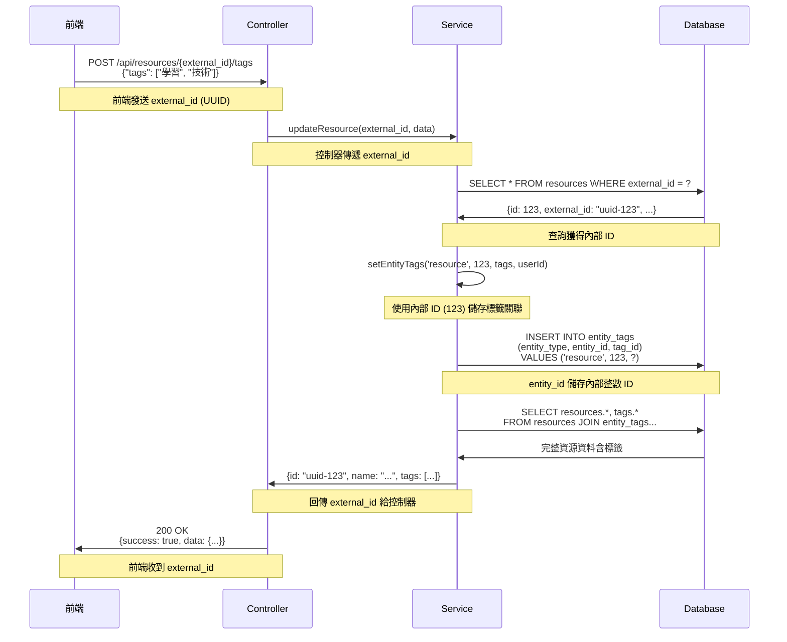

# Entity ID 處理策略指南

## 概述

本文件說明 DaoDao 系統中關於 ID 處理的標準策略，特別是內部整數 ID (int) 與對外 UUID (external_id) 的使用規範。

## 核心原則

### 1. 雙層 ID 架構

系統採用雙層 ID 架構以兼顧安全性與效能：

- **內部 ID (`id`)**: 整數型別，用於資料庫內部關聯和查詢
- **外部 ID (`external_id`)**: UUID 字串，用於 API 對外溝通

### 2. 資料庫層規範

#### 2.1 主要資料表結構

```sql
-- 正確的資料表設計
CREATE TABLE resources (
    id          INT PRIMARY KEY,        -- 內部使用
    external_id UUID UNIQUE,            -- 對外使用
    ...
);
```

#### 2.2 關聯資料表 (entity_tags, entity_resources)

```sql
-- entity_id 必須儲存整數 ID
CREATE TABLE entity_tags (
    entity_type VARCHAR(50),
    entity_id   INT,                    -- 永遠存內部整數 ID
    tag_id      INT,
    ...
);
```

**重要**: `entity_id` 欄位必須儲存資料表的 `id` (整數)，而非 `external_id` (UUID)。

### 3. 服務層實作規範

#### 3.1 正確範例 ✅

**resource.service.ts**

```typescript
// 內部查詢：使用整數 ID
const rawTags = await prisma.$queryRaw`
    SELECT * FROM entity_tags 
    WHERE entity_type = 'resource'
    AND entity_id::integer = ${resource.id}  -- 使用內部 ID
`;

// API 輸出：轉換為 external_id
const resourceList = resources.map(resource => ({
    id: resource.external_id,  // 對外輸出 UUID
    name: resource.name,
    // ...
}));
```

**tag.service.ts**

```typescript
// 函數簽名正確使用 number 型別
export async function setEntityTags(
    entityType: string,
    entityId: number,  // 內部 ID 為 number
    tagNames: string[],
    userId: number
): Promise<void> {
    // 儲存時使用整數 ID
    await prisma.entity_tags.create({
        data: {
            entity_type: entityType,
            entity_id: entityId,  // 直接使用整數
            tag_id: tag.id
        }
    });
}
```

#### 3.2 錯誤範例 ❌

**idea.service.ts (需要修正)**

```typescript
// 錯誤：entity_id 不應儲存 UUID
await prisma.entity_tags.findMany({
    where: {
        entity_type: 'idea',
        entity_id: idea.external_id  // ❌ 錯誤！應該用 idea.id
    }
});

// 正確寫法
await prisma.entity_tags.findMany({
    where: {
        entity_type: 'idea',
        entity_id: idea.id  // ✅ 使用內部整數 ID
    }
});
```

### 4. API 層規範與完整流程

#### 4.1 前端到後端完整流程



#### 4.2 統一的 ID 轉換服務

**背景**：目前系統中已經有部分 ID 轉換邏輯（如 `comment.service.ts` 的 `getTargetEntity` 方法），但邏輯分散且不可重用。統一的 ID 轉換服務整合這些邏輯，提供一致的介面。

**ID 轉換服務 (id-converter.service.ts)**

```typescript
import idConverter from '@/services/id-converter.service';

// 基本轉換功能
const internalId = await idConverter.externalToInternalId('resource', externalId);
const externalId = await idConverter.internalToExternalId('resource', internalId);

// 獲取完整實體資訊
const entityInfo = await idConverter.getEntityInfo('resource', externalId);
// 返回: { id: 123, external_id: "uuid-123", tableName: "resources" }

// 批量轉換
const internalIds = await idConverter.batchExternalToInternalIds('resource', externalIds);

// 智慧轉換（自動判斷輸入格式）
const { internalId, externalId } = await idConverter.smartIdConvert('resource', inputId);
```

**控制器層 (Controller) - 使用統一服務**

```typescript
import idConverter from '@/services/id-converter.service';

// POST /api/resources/:id/tags
export const updateResourceTags = asyncWrapper(async (req: Request, res: Response) => {
    const externalId = req.params.id;  // 接收 external_id (UUID)
    const { tags } = req.body;
    const userId = req.user?.id;
    
    // 使用統一的 ID 轉換服務
    const internalId = await idConverter.externalToInternalId('resource', externalId);
    
    // 傳遞內部 ID 給服務層
    const resource = await resourceService.updateResourceTags(internalId, tags, userId);
    
    res.json({
        success: true,
        data: resource  // 服務層已處理 external_id 回傳
    });
});
```

**服務層 (Service) - 直接使用內部 ID**

```typescript
import idConverter from '@/services/id-converter.service';

// 服務層直接使用內部 ID，無需處理轉換
async function updateResourceTags(internalId: number, tags: string[], userId: number) {
    return await prisma.$transaction(async (tx) => {
        // 直接使用內部 ID 進行操作
        await setEntityTags('resource', internalId, tags, userId, tx);
        
        // 查詢並轉換回傳格式
        const resource = await tx.resources.findUnique({
            where: { id: internalId },
            include: { /* ... */ }
        });
        
        // 返回時確保使用 external_id
        return {
            id: resource.external_id,  // 對外使用 UUID
            name: resource.name,
            tags: /* ... */
        };
    });
}

// 或者使用更簡潔的方式
async function updateResourceTags(internalId: number, tags: string[], userId: number) {
    await setEntityTags('resource', internalId, tags, userId);
    
    // 使用 ID 轉換服務獲取 external_id
    const externalId = await idConverter.internalToExternalId('resource', internalId);
    
    return await getResourceById(externalId);  // 回傳完整資料
}
```

#### 4.3 資料格式轉換

**輸入格式 (前端 → 後端)**

```json
{
    "id": "550e8400-e29b-41d4-a716-446655440000",  // external_id (UUID)
    "name": "React 學習資源",
    "tags": ["前端", "React", "JavaScript"]
}
```

**內部處理格式**

```typescript
// 資料庫查詢使用內部 ID
const resource = { 
    id: 123,                                    // 內部整數 ID
    external_id: "550e8400-e29b-41d4-a716-446655440000",
    name: "React 學習資源"
};

// entity_tags 表儲存
{
    entity_type: "resource",
    entity_id: 123,        // 儲存內部整數 ID，不是 UUID
    tag_id: 456
}
```

**輸出格式 (後端 → 前端)**

```json
{
    "success": true,
    "data": {
        "id": "550e8400-e29b-41d4-a716-446655440000",  // external_id (UUID)
        "name": "React 學習資源",
        "tags": [
            {
                "id": 456,
                "name": "前端"
            },
            {
                "id": 457,
                "name": "React"
            }
        ]
    }
}
```

## 實作檢查清單

### 🔍 **現有 ID 轉換邏輯分析**

**已存在的轉換邏輯**：

- ✅ **comment.service.ts**: `getTargetEntity` 方法已處理多種實體類型的 ID 轉換
- ✅ **resource.service.ts**: 正確使用內部 ID 儲存，external_id 輸出
- ✅ **tag.service.ts**: 參數定義正確使用 number 型別
- ✅ **practice.service.ts**: 使用整數 ID

**已修正完成的服務**：

- ✅ **idea.service.ts**: 修正 entity_id 儲存邏輯，使用內部整數 ID
- ✅ **resource-review.service.ts**: 統一使用數字型別，移除不必要轉換
- ✅ **tag.controller.ts**: 修正控制器參數轉換為整數

**重構完成的整合**：

- ✅ **統一 ID 轉換服務**: 已建立 `id-converter.service.ts` 並整合現有邏輯
- ✅ **comment.service.ts**: 已重構使用統一的 ID 轉換服務

## 最佳實踐

1. **永遠不要**在 `entity_id` 欄位儲存 UUID
2. **內部處理**一律使用整數 ID 以提升查詢效能
3. **API 輸出**一律使用 external_id 以保護內部結構
4. **型別安全**：確保 TypeScript 型別定義正確

   ```typescript
   interface EntityTag {
       entity_type: string;
       entity_id: number;  // 不是 string!
       tag_id: number;
   }
   ```

5. **資料遷移**：如果發現舊資料使用 UUID，需要進行資料遷移

   ```sql
   -- 範例：修正錯誤儲存的 UUID
   UPDATE entity_tags et
   SET entity_id = i.id
   FROM ideas i
   WHERE et.entity_type = 'idea'
   AND et.entity_id::text = i.external_id::text;
   ```

6. **使用統一的 ID 轉換服務**：避免在控制器中重複轉換邏輯

   ```typescript
   // ✅ 正確：使用統一的 ID 轉換服務
   import idConverter from '@/services/id-converter.service';
   
   app.get('/api/resources/:id/tags', async (req, res) => {
       const externalId = req.params.id;  // UUID
       const internalId = await idConverter.externalToInternalId('resource', externalId);
       const tags = await getEntityTags('resource', internalId);
   });
   
   // ❌ 錯誤：在控制器中直接查詢轉換
   app.get('/api/resources/:id/tags', async (req, res) => {
       const externalId = req.params.id;
       const resource = await prisma.resources.findUnique({
           where: { external_id: externalId }  // 重複的轉換邏輯
       });
       const tags = await getEntityTags('resource', resource.id);
   });
   ```

7. **智慧 ID 處理**：使用智慧轉換處理混合格式輸入

   ```typescript
   // ✅ 支援多種輸入格式
   const { internalId, externalId } = await idConverter.smartIdConvert('resource', inputId);
   
   // 無論 inputId 是 "123" 還是 "550e8400-e29b-41d4-a716-446655440000"
   // 都能正確處理並回傳兩種格式的 ID
   ```

## 常見錯誤與解決方案

### 錯誤 1: 直接儲存 UUID 到 entity_id

```typescript
// ❌ 錯誤寫法
await prisma.entity_tags.create({
    data: {
        entity_type: 'resource',
        entity_id: resource.external_id,  // UUID 字串
        tag_id: tagId
    }
});

// ✅ 正確寫法
await prisma.entity_tags.create({
    data: {
        entity_type: 'resource',
        entity_id: resource.id,  // 內部整數 ID
        tag_id: tagId
    }
});
```

### 錯誤 2: 型別不匹配

```typescript
// ❌ 錯誤：entity_id 被定義為字串
const tagsByEntityId = {} as Record<string, Array<Tag>>;

// ✅ 正確：entity_id 應該是數字
const tagsByEntityId = {} as Record<number, Array<Tag>>;
```

### 錯誤 3: 查詢時使用錯誤的 ID

```typescript
// ❌ 錯誤：使用 external_id 查詢 entity_tags
const tags = await prisma.entity_tags.findMany({
    where: {
        entity_type: 'resource',
        entity_id: resource.external_id  // 錯誤！
    }
});

// ✅ 正確：使用內部 ID 查詢
const tags = await prisma.entity_tags.findMany({
    where: {
        entity_type: 'resource',  
        entity_id: resource.id  // 正確！
    }
});
```

### 錯誤 4: 在控制器中重複 ID 轉換邏輯

```typescript
// ❌ 錯誤：每個控制器都重複轉換邏輯
export const getResourceTags = async (req, res) => {
    const resource = await prisma.resources.findUnique({
        where: { external_id: req.params.id }  // 重複邏輯
    });
    // ...
};

export const updateResourceTags = async (req, res) => {
    const resource = await prisma.resources.findUnique({
        where: { external_id: req.params.id }  // 重複邏輯
    });
    // ...
};

// ✅ 正確：使用統一的 ID 轉換服務
import idConverter from '@/services/id-converter.service';

export const getResourceTags = async (req, res) => {
    const internalId = await idConverter.externalToInternalId('resource', req.params.id);
    // ...
};

export const updateResourceTags = async (req, res) => {
    const internalId = await idConverter.externalToInternalId('resource', req.params.id);
    // ...
};
```

### 錯誤 5: 服務層處理 ID 轉換

```typescript
// ❌ 錯誤：服務層不應該處理 external_id
async function updateResourceTags(externalId: string, tags: string[]) {
    const resource = await prisma.resources.findUnique({
        where: { external_id: externalId }  // 服務層不應該處理轉換
    });
    await setEntityTags('resource', resource.id, tags);
}

// ✅ 正確：服務層只處理內部 ID
async function updateResourceTags(internalId: number, tags: string[]) {
    await setEntityTags('resource', internalId, tags);  // 直接使用內部 ID
}
```

## 效能考量

- **整數 ID 查詢**比 UUID 查詢快約 2-4 倍
- **索引大小**：整數索引比 UUID 索引小約 4 倍
- **JOIN 操作**：使用整數 ID 可顯著提升 JOIN 效能

## 安全考量

- **不暴露內部 ID**：避免洩漏資料庫規模和成長速度
- **UUID 不可預測**：防止資料爬取和未授權存取
- **關聯完整性**：內部使用整數確保參考完整性

## 驗證與測試

### 資料庫驗證查詢

檢查 entity_id 是否正確儲存為整數：

```sql
-- 檢查 entity_tags 表中的資料類型
SELECT 
    entity_type,
    entity_id,
    pg_typeof(entity_id) as id_type,
    COUNT(*) as count
FROM entity_tags 
GROUP BY entity_type, pg_typeof(entity_id)
ORDER BY entity_type;

-- 檢查是否有儲存 UUID 格式的錯誤資料
SELECT entity_type, entity_id
FROM entity_tags 
WHERE entity_id::text ~ '^[0-9a-f]{8}-[0-9a-f]{4}-[0-9a-f]{4}-[0-9a-f]{4}-[0-9a-f]{12}$'
LIMIT 10;
```

### 單元測試範例

```typescript
describe('Entity ID Handling', () => {
    test('should store internal ID in entity_tags', async () => {
        const resource = await createResource({ name: 'Test Resource' });
        
        await setEntityTags('resource', resource.id, ['test-tag'], userId);
        
        const storedTag = await prisma.entity_tags.findFirst({
            where: { 
                entity_type: 'resource',
                entity_id: resource.id  // 確保使用整數 ID
            }
        });
        
        expect(storedTag.entity_id).toBe(resource.id);
        expect(typeof storedTag.entity_id).toBe('number');
    });
    
    test('should return external_id in API response', async () => {
        const resource = await createResource({ name: 'Test Resource' });
        
        const response = await request(app)
            .get(`/api/resources/${resource.external_id}`)
            .expect(200);
        
        expect(response.body.data.id).toBe(resource.external_id);
        expect(response.body.data.id).toMatch(/^[0-9a-f-]{36}$/); // UUID 格式
    });
});

describe('ID Converter Service', () => {
    test('should convert external_id to internal_id', async () => {
        const resource = await createResource({ name: 'Test Resource' });
        
        const internalId = await idConverter.externalToInternalId('resource', resource.external_id);
        
        expect(internalId).toBe(resource.id);
        expect(typeof internalId).toBe('number');
    });
    
    test('should convert internal_id to external_id', async () => {
        const resource = await createResource({ name: 'Test Resource' });
        
        const externalId = await idConverter.internalToExternalId('resource', resource.id);
        
        expect(externalId).toBe(resource.external_id);
        expect(externalId).toMatch(/^[0-9a-f-]{36}$/);
    });
    
    test('should handle batch conversion', async () => {
        const resources = await Promise.all([
            createResource({ name: 'Resource 1' }),
            createResource({ name: 'Resource 2' })
        ]);
        
        const externalIds = resources.map(r => r.external_id);
        const internalIds = await idConverter.batchExternalToInternalIds('resource', externalIds);
        
        expect(internalIds).toHaveLength(2);
        expect(internalIds[0]).toBe(resources[0].id);
        expect(internalIds[1]).toBe(resources[1].id);
    });
    
    test('should throw error for non-existent entity', async () => {
        const fakeUuid = '00000000-0000-0000-0000-000000000000';
        
        await expect(
            idConverter.externalToInternalId('resource', fakeUuid)
        ).rejects.toThrow('resource 不存在');
    });
    
    test('should validate UUID format', () => {
        const validUuid = '550e8400-e29b-41d4-a716-446655440000';
        const invalidUuid = 'not-a-uuid';
        
        expect(idConverter.isValidUUID(validUuid)).toBe(true);
        expect(idConverter.isValidUUID(invalidUuid)).toBe(false);
    });
    
    test('should handle smart conversion', async () => {
        const resource = await createResource({ name: 'Test Resource' });
        
        // 測試 UUID 輸入
        const result1 = await idConverter.smartIdConvert('resource', resource.external_id);
        expect(result1.internalId).toBe(resource.id);
        expect(result1.externalId).toBe(resource.external_id);
        
        // 測試數字輸入
        const result2 = await idConverter.smartIdConvert('resource', resource.id);
        expect(result2.internalId).toBe(resource.id);
        expect(result2.externalId).toBe(resource.external_id);
        
        // 測試字串數字輸入
        const result3 = await idConverter.smartIdConvert('resource', resource.id.toString());
        expect(result3.internalId).toBe(resource.id);
        expect(result3.externalId).toBe(resource.external_id);
    });
});
```

### API 測試驗證

```bash
# 測試 API 端點正確處理 UUID
curl -X POST "http://localhost:3000/api/resources/550e8400-e29b-41d4-a716-446655440000/tags" \
  -H "Content-Type: application/json" \
  -H "Authorization: Bearer your-jwt-token" \
  -d '{"tags": ["測試標籤"]}'

# 驗證回應格式
# 應該回傳 external_id (UUID)，而非內部 ID
```

## 部署前檢查清單

### 資料庫層面

- [ ] 確認所有 `entity_id` 欄位儲存為整數型別
- [ ] 執行資料庫驗證查詢，檢查是否有 UUID 格式的錯誤資料
- [ ] 執行資料庫遷移修正歷史錯誤資料

### 程式碼層面

- [x] 所有控制器已導入並使用 `id-converter.service.ts`
- [x] 移除控制器中重複的 ID 轉換邏輯
- [x] 服務層函數簽名改為接收內部 ID (number)
- [x] 確認 TypeScript 編譯無錯誤
- [x] 檢查所有 `entity_id` 相關型別定義為 `number`

### API 層面

- [ ] 驗證 API 端點回傳 `external_id` 而非內部 ID
- [ ] 確認所有 URL 參數使用 `external_id` (UUID)
- [ ] 測試 API 端點正確處理 UUID 輸入

### 測試層面

- [ ] 執行 ID 轉換服務的單元測試
- [ ] 執行相關業務邏輯的整合測試
- [ ] 驗證批量轉換功能正常運作
- [ ] 測試錯誤處理 (不存在的 ID、無效 UUID 等)

### 效能層面

- [ ] 檢查查詢效能是否符合預期提升
- [ ] 驗證資料庫索引是否正確建立在整數 ID 欄位上
- [ ] 測試批量操作的效能表現

### 安全層面

- [ ] 確認 API 回應不會洩漏內部 ID
- [ ] 驗證 UUID 格式驗證功能正常
- [ ] 檢查錯誤訊息不會暴露敏感資訊

## 結論

遵循此 ID 處理策略並使用統一的 ID 轉換服務可確保系統同時具備：

- **高效能的內部查詢**：整數 ID 提供最佳查詢效能
- **安全的對外介面**：UUID 保護內部結構不被暴露
- **清晰的程式碼結構**：統一服務避免重複邏輯
- **容易維護的資料關聯**：一致的 ID 處理模式
- **一致的資料格式轉換流程**：標準化的轉換過程
- **可重用的轉換邏輯**：統一服務降低維護成本
- **錯誤處理一致性**：統一的錯誤處理和驗證
- **測試覆蓋率提升**：集中的邏輯便於測試

## ID 轉換服務的優勢

1. **DRY 原則**：避免在多個控制器中重複相同的轉換邏輯
2. **集中管理**：所有 ID 轉換邏輯集中在一個服務中，便於維護
3. **型別安全**：統一的型別定義和驗證
4. **批量處理**：支援批量 ID 轉換，提升效能
5. **智慧轉換**：自動判斷輸入格式，提升開發體驗
6. **錯誤一致性**：統一的錯誤處理和訊息格式

開發時請務必遵守這些規範，並使用統一的 ID 轉換服務，確保系統的一致性和可維護性。
