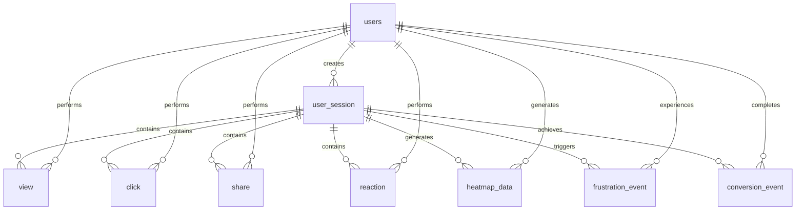

# DaoDao 平台 GA + Clarity 整合追蹤系統規劃

## 📊 系統概述

本文件規劃整合 Google Analytics 與 Microsoft Clarity 功能的全方位用戶行為追蹤系統，用於 DaoDao 學習平台的數據分析與用戶體驗優化。

### 目標
- 建立完整的用戶行為追蹤機制（GA 風格）
- 提供視覺化用戶體驗分析（Clarity 熱力圖與會話重播）
- 支援個人化推薦與內容優化
- 監控平台健康度與用戶參與度
- 識別使用者挫折點與體驗痛點
- 提供深度的學習行為洞察分析

## 🏗️ 現有基礎架構

### 已建立的追蹤表格
根據 `init-scripts/` 中的 SQL 腳本，平台已具備以下追蹤表格：

#### 1. 瀏覽追蹤 (`view` 表) - 現有設計
```sql
-- 現有表格結構（360_create_table_view.sql）
CREATE TABLE "view" (
    "id" SERIAL PRIMARY KEY,
    "user_id" INT NOT NULL,
    "target_type" VARCHAR(20) NOT NULL 
        CHECK ("target_type" IN ('project','post', 'resource','note','outcome','review', 'circle', 'idea','portfolio')),
    "target_id" INT NOT NULL,
    "duration" INT,  -- 停留時間（秒）
    "created_at" TIMESTAMP DEFAULT CURRENT_TIMESTAMP,
    "updated_at" TIMESTAMP DEFAULT CURRENT_TIMESTAMP,
    FOREIGN KEY ("user_id") REFERENCES "users"("id"),
    UNIQUE ("user_id", "target_type", "target_id")
);
CREATE INDEX idx_view_user_target ON "view"("user_id", "target_type", "target_id");
CREATE INDEX idx_view_target ON "view"("target_type", "target_id");
```

**存在問題與建議改善：**
- ❌ UNIQUE 限制過嚴：不允許同一用戶多次瀏覽同一內容
- ❌ 缺少設備資訊、瀏覽器資訊
- ❌ 缺少頁面路徑、來源頁面資訊
- ❌ 缺少滾動深度、退出意圖等 UX 指標

#### 2. 點擊追蹤 (`click` 表) - 現有設計
```sql
-- 現有表格結構（380_create_table_click.sql）
CREATE TABLE "click" (
    "id" SERIAL PRIMARY KEY,
    "user_id" INT NOT NULL,
    "target_type" VARCHAR(20) NOT NULL 
        CHECK ("target_type" IN ('project','post', 'resource','note','outcome','review', 'circle', 'idea','portfolio')),
    "target_id" INT NOT NULL,
    "click_position" VARCHAR(50),  -- 如點擊區域、元素名稱等
    "created_at" TIMESTAMP DEFAULT CURRENT_TIMESTAMP,
    "updated_at" TIMESTAMP DEFAULT CURRENT_TIMESTAMP,
    FOREIGN KEY ("user_id") REFERENCES "users"("id"),
    UNIQUE ("user_id", "target_type", "target_id")
);
CREATE INDEX idx_click_user_target ON "click"("user_id", "target_type", "target_id");
CREATE INDEX idx_click_target ON "click"("target_type", "target_id");
CREATE INDEX idx_click_position ON "click"("click_position");
```

**存在問題與建議改善：**
- ❌ UNIQUE 限制：不允許同一用戶多次點擊同一內容
- ❌ 缺少座標資訊 (x, y)
- ❌ 缺少元素選擇器、元素文字
- ❌ 缺少點擊類型分類（正常點擊 vs rage click）
- ✅ 已有 click_position 欄位，但定義不夠詳細

#### 3. 互動追蹤 (`reaction` 表) - 現有設計
```sql
-- 現有表格結構（340_create_table_reaction.sql）
CREATE TYPE reaction_type AS ENUM ('like');

CREATE TABLE "reaction" (
    "id" SERIAL PRIMARY KEY,
    "user_id" INT NOT NULL,
    "target_type" VARCHAR(20) NOT NULL 
        CHECK ("target_type" IN ('project','post', 'resource','note','outcome','review', 'circle', 'idea','portfolio')),
    "target_id" INT NOT NULL,
    "reaction_type" reaction_type NOT NULL,
    "weight" INT DEFAULT 1,  -- 為不同反應賦予不同權重
    "created_at" TIMESTAMP DEFAULT CURRENT_TIMESTAMP,
    "updated_at" TIMESTAMP DEFAULT CURRENT_TIMESTAMP,
    UNIQUE ("user_id", "target_type", "target_id", "reaction_type"),
    FOREIGN KEY ("user_id") REFERENCES "users"("id")
);
CREATE INDEX idx_reaction_user_target ON "reaction"("user_id", "target_type", "target_id");
CREATE INDEX idx_reaction_target ON "reaction"("target_type", "target_id", "reaction_type");
```

**優點與改善建議：**
- ✅ 已有權重系統設計
- ✅ UNIQUE 限制合理（每種反應類型只能有一個）
- ❌ reaction_type ENUM 過於簡單，僅支援 'like'
- ➕ 建議擴展：'love', 'laugh', 'wow', 'sad', 'angry', 'care'

#### 4. 收藏追蹤 (`favorite` 表) - 現有設計
```sql
-- 現有表格結構（350_create_table_favorite.sql）
CREATE TABLE "favorite" (
    "id" SERIAL PRIMARY KEY,
    "user_id" INT NOT NULL,
    "target_type" VARCHAR(20) NOT NULL 
        CHECK ("target_type" IN ('project','post', 'resource','note','outcome','review', 'circle', 'idea','portfolio')),
    "target_id" INT NOT NULL,
    "created_at" TIMESTAMP DEFAULT CURRENT_TIMESTAMP,
    "updated_at" TIMESTAMP DEFAULT CURRENT_TIMESTAMP,
    UNIQUE ("user_id", "target_type", "target_id"),
    FOREIGN KEY ("user_id") REFERENCES "users"("id")
);
CREATE INDEX idx_favorite_user_target ON "favorite"("user_id", "target_type", "target_id");
CREATE INDEX idx_favorite_target ON "favorite"("target_type", "target_id");
```

**現有問題：**
- ✅ UNIQUE 限制合理（每個內容只能收藏一次）
- ❌ 缺少分類功能
- ❌ 缺少收藏標籤或資料夾功能
- ❌ 缺少收藏原因或註解欄位
- ❌ 缺少 session_id 追蹤

#### 5. 分享追蹤 (`share` 表) - 現有設計
```sql
-- 現有表格結構（370_create_table_share.sql）
CREATE TABLE "share" (
    "id" SERIAL PRIMARY KEY,
    "user_id" INT NOT NULL,
    "target_type" VARCHAR(20) NOT NULL 
        CHECK ("target_type" IN ('project','post', 'resource','note','outcome','review', 'circle', 'idea','portfolio')),
    "target_id" INT NOT NULL,
    "share_channel" VARCHAR(50),  -- 分享渠道，如社交平台名稱
    "created_at" TIMESTAMP DEFAULT CURRENT_TIMESTAMP,
    "updated_at" TIMESTAMP DEFAULT CURRENT_TIMESTAMP,
    FOREIGN KEY ("user_id") REFERENCES "users"("id"),
    UNIQUE ("user_id", "target_type", "target_id")
);
CREATE INDEX idx_share_user_target ON "share"("user_id", "target_type", "target_id");
CREATE INDEX idx_share_target ON "share"("target_type", "target_id");
CREATE INDEX idx_share_channel ON "share"("share_channel");
```

**現有問題：**
- ✅ 基本設計合理，已有分享渠道記錄  
- ❌ UNIQUE 限制：不允許同一用戶多次分享同一內容
- ❌ 缺少分享成功/失敗狀態
- ❌ 缺少分享自訂訊息或標題
- ❌ 缺少分享點擊回流追蹤
- ❌ 缺少 session_id 追蹤

### 6. 現有追蹤表格深度分析

#### 6.1 表格結構問題診斷

**ℹ️ 注意：現有表格的註解與實際結構不符**
- view 表註解說「允許同一使用者對同一對象有多筆記錄」
- 但實際有 UNIQUE 限制，不允許多筆記錄

**1. UNIQUE 限制過於嚴格問題**
- ❌ **view 表**：UNIQUE(user_id, target_type, target_id) 限制
- ❌ **click 表**：UNIQUE(user_id, target_type, target_id) 限制
- ❌ **share 表**：UNIQUE(user_id, target_type, target_id) 限制
- ✅ **reaction 表**：UNIQUE(user_id, target_type, target_id, reaction_type) 合理
- ✅ **favorite 表**：UNIQUE(user_id, target_type, target_id) 合理

**2. 缺少 GA/Clarity 關鍵欄位**

| 表格 | 缺少欄位 | 影響 |
|------|----------|------|
| view | session_id, page_url, scroll_depth, device_info | 無法做會話級分析 |
| click | coordinates_x/y, element_selector, session_id | 無法產生熱力圖 |
| reaction | session_id, page_context | 無法與其他事件關聯 |
| favorite | session_id, category, notes | 缺少上下文資訊 |
| share | session_id, success_status, custom_message | 無法追蹤分享成效 |

**3. 時間戳系統不一致**
- 部分表格使用 TIMESTAMP，部分使用 TIMESTAMPTZ
- 建議統一使用 TIMESTAMPTZ 支援全球使用者

#### 6.2 支援的追蹤目標類型
根據現有資料庫設計，所有追蹤表格都支援以下目標類型：
- `project` - 學習專案
- `post` - 一般貼文（統一內容表）
- `resource` - 學習資源（TypeScript 新系統）
- `note` - 學習筆記（post 子類型）
- `outcome` - 學習成果（post 子類型）
- `review` - 週反思（post 子類型）
- `circle` - 揪團活動
- `idea` - 想法分享
- `portfolio` - 作品集

#### 6.3 現有追蹤能力優勣勢
根據 API_GUIDE.md 分析：

**優勢：**
- ✅ **多型關聯設計**：`target_type` + `target_id` 模式彈性高
- ✅ **完整互動追蹤**：view, click, reaction, favorite, share 五大類
- ✅ **權重系統**：reaction 表已有 weight 權重設計
- ✅ **軟刪除支援**：主要表格都有 deleted_at 欄位
- ✅ **索引優化**：已有基本索引結構

**劣勢：**
- ❌ **UNIQUE 限制過嚴**：阻礙行為模式分析
- ❌ **缺少會話管理**：無法做用戶旅程分析
- ❌ **缺少 UX 指標**：無法做體驗優化
- ❌ **metadata 未充分利用**：click 表有 metadata_json 但用法不明

#### 6.4 建議修正策略

**策略 A：非破壞性擴展（建議）**
1. 保持現有表格結構不變
2. 新增補充欄位（ALTER TABLE ADD COLUMN）
3. 新增新表格補強功能
4. 逐步遷移數據到新系統

**策略 B：直接修正（風險較高）**
1. 移除有問題的 UNIQUE 限制
2. 直接修正表格結構
3. 需要停機維護時間

### 6.5 關鍵問題確認

**🚨 重要發現：view 表註解與實際約束衝突**

根據分析 `360_create_table_view.sql` 檔案：
```sql
-- 第14行註解：
-- 此表允許同一使用者對同一對象有多筆記錄

-- 但第13行實際約束：
UNIQUE ("user_id", "target_type", "target_id")
```

這個矛盾導致：
- 註解說可以多筆記錄，但 UNIQUE 約束阻止了
- 同樣問題存在於 click 和 share 表
- 嚴重影響 GA 和 Clarity 追蹤功能

**解決方案優先級：**
1. **立即移除 UNIQUE 約束**（恢復預期功能）
2. **新增 session_id 欄位**（支援會話分析）  
3. **擴展座標與設備資訊**（支援熱力圖）

## 7. 立即修正 SQL 指令

### 7.1 移除過度限制的 UNIQUE 約束

**修正 view 表**
```sql
-- 1. 移除現有的 unique 約束
ALTER TABLE "view" DROP CONSTRAINT IF EXISTS "view_user_id_target_type_target_id_key";

-- 2. （可選）新增複合索引以提升查詢效能
CREATE INDEX IF NOT EXISTS idx_view_user_target_time 
    ON "view"("user_id", "target_type", "target_id", "created_at");
```

**修正 click 表**
```sql
-- 1. 移除現有的 unique 約束
ALTER TABLE "click" DROP CONSTRAINT IF EXISTS "click_user_id_target_type_target_id_key";

-- 2. 新增時間戳索引以支援熱力圖查詢
CREATE INDEX IF NOT EXISTS idx_click_user_target_time 
    ON "click"("user_id", "target_type", "target_id", "created_at");
```

**修正 share 表**
```sql
-- 1. 移除現有的 unique 約束
ALTER TABLE "share" DROP CONSTRAINT IF EXISTS "share_user_id_target_type_target_id_key";

-- 2. 新增分享頻率分析索引
CREATE INDEX IF NOT EXISTS idx_share_user_target_time 
    ON "share"("user_id", "target_type", "target_id", "created_at");
```

### 7.2 擴展現有表格欄位

**擴展 view 表 - 支援 GA 分析**
```sql
-- 新增 session 追蹤
ALTER TABLE "view" ADD COLUMN IF NOT EXISTS "session_id" VARCHAR(64);
ALTER TABLE "view" ADD COLUMN IF NOT EXISTS "page_url" VARCHAR(500);
ALTER TABLE "view" ADD COLUMN IF NOT EXISTS "referrer_url" VARCHAR(500);

-- 新增設備與瀏覽器資訊
ALTER TABLE "view" ADD COLUMN IF NOT EXISTS "user_agent" TEXT;
ALTER TABLE "view" ADD COLUMN IF NOT EXISTS "ip_address" INET;
ALTER TABLE "view" ADD COLUMN IF NOT EXISTS "device_type" VARCHAR(20) 
    CHECK ("device_type" IN ('desktop', 'mobile', 'tablet'));

-- 新增 UX 指標
ALTER TABLE "view" ADD COLUMN IF NOT EXISTS "scroll_depth" DECIMAL(5,2); -- 滾動深度百分比
ALTER TABLE "view" ADD COLUMN IF NOT EXISTS "exit_intent" BOOLEAN DEFAULT FALSE;
ALTER TABLE "view" ADD COLUMN IF NOT EXISTS "viewport_width" INT;
ALTER TABLE "view" ADD COLUMN IF NOT EXISTS "viewport_height" INT;

-- 新增索引
CREATE INDEX IF NOT EXISTS idx_view_session ON "view"("session_id");
CREATE INDEX IF NOT EXISTS idx_view_device ON "view"("device_type");
```

**擴展 click 表 - 支援熱力圖**
```sql
-- 新增座標資訊
ALTER TABLE "click" ADD COLUMN IF NOT EXISTS "click_x" INT; -- X 座標
ALTER TABLE "click" ADD COLUMN IF NOT EXISTS "click_y" INT; -- Y 座標
ALTER TABLE "click" ADD COLUMN IF NOT EXISTS "element_selector" VARCHAR(200); -- CSS 選擇器
ALTER TABLE "click" ADD COLUMN IF NOT EXISTS "element_text" VARCHAR(100); -- 元素文字

-- 新增點擊類型分析
ALTER TABLE "click" ADD COLUMN IF NOT EXISTS "click_type" VARCHAR(20) DEFAULT 'normal'
    CHECK ("click_type" IN ('normal', 'rage', 'dead', 'error'));
ALTER TABLE "click" ADD COLUMN IF NOT EXISTS "session_id" VARCHAR(64);

-- 新增頁面與設備資訊
ALTER TABLE "click" ADD COLUMN IF NOT EXISTS "page_url" VARCHAR(500);
ALTER TABLE "click" ADD COLUMN IF NOT EXISTS "user_agent" TEXT;
ALTER TABLE "click" ADD COLUMN IF NOT EXISTS "viewport_width" INT;
ALTER TABLE "click" ADD COLUMN IF NOT EXISTS "viewport_height" INT;

-- 新增索引
CREATE INDEX IF NOT EXISTS idx_click_coordinates ON "click"("click_x", "click_y");
CREATE INDEX IF NOT EXISTS idx_click_type ON "click"("click_type");
CREATE INDEX IF NOT EXISTS idx_click_session ON "click"("session_id");
```

**擴展 reaction 表 - 支援更多互動類型**
```sql
-- 擴展反應類型
ALTER TYPE reaction_type ADD VALUE IF NOT EXISTS 'love';
ALTER TYPE reaction_type ADD VALUE IF NOT EXISTS 'laugh';
ALTER TYPE reaction_type ADD VALUE IF NOT EXISTS 'wow';
ALTER TYPE reaction_type ADD VALUE IF NOT EXISTS 'sad';
ALTER TYPE reaction_type ADD VALUE IF NOT EXISTS 'angry';
ALTER TYPE reaction_type ADD VALUE IF NOT EXISTS 'care';

-- 新增 session 追蹤
ALTER TABLE "reaction" ADD COLUMN IF NOT EXISTS "session_id" VARCHAR(64);
ALTER TABLE "reaction" ADD COLUMN IF NOT EXISTS "page_url" VARCHAR(500);

-- 新增索引
CREATE INDEX IF NOT EXISTS idx_reaction_session ON "reaction"("session_id");
```

**擴展 share 表 - 支援分享渠道分析**
```sql
-- 新增分享渠道資訊
ALTER TABLE "share" ADD COLUMN IF NOT EXISTS "share_channel" VARCHAR(50); -- facebook, twitter, line, email, copy_link
ALTER TABLE "share" ADD COLUMN IF NOT EXISTS "session_id" VARCHAR(64);
ALTER TABLE "share" ADD COLUMN IF NOT EXISTS "page_url" VARCHAR(500);
ALTER TABLE "share" ADD COLUMN IF NOT EXISTS "referrer_url" VARCHAR(500);

-- 新增分享成功追蹤
ALTER TABLE "share" ADD COLUMN IF NOT EXISTS "share_completed" BOOLEAN DEFAULT FALSE;
ALTER TABLE "share" ADD COLUMN IF NOT EXISTS "completion_time" TIMESTAMP;

-- 新增索引
CREATE INDEX IF NOT EXISTS idx_share_channel ON "share"("share_channel");
CREATE INDEX IF NOT EXISTS idx_share_session ON "share"("session_id");
CREATE INDEX IF NOT EXISTS idx_share_completed ON "share"("share_completed");
```

## 8. 新增追蹤表格設計

### 8.1 用戶會話表 (user_session)

```sql
-- 570_create_table_user_session.sql
CREATE TABLE "user_session" (
    "id" SERIAL PRIMARY KEY,
    "session_id" VARCHAR(64) UNIQUE NOT NULL,
    "user_id" INT,
    "start_time" TIMESTAMP DEFAULT CURRENT_TIMESTAMP,
    "end_time" TIMESTAMP,
    "duration" INT, -- 會話持續時間（秒）
    "page_count" INT DEFAULT 0, -- 瀏覽頁面數
    "event_count" INT DEFAULT 0, -- 總事件數
    "is_bounce" BOOLEAN DEFAULT FALSE, -- 是否為跳出會話
    "entry_page" VARCHAR(500), -- 進入頁面
    "exit_page" VARCHAR(500), -- 離開頁面
    "referrer_url" VARCHAR(500), -- 來源網址
    "utm_source" VARCHAR(100), -- UTM 來源
    "utm_medium" VARCHAR(100), -- UTM 媒介
    "utm_campaign" VARCHAR(100), -- UTM 活動
    "device_type" VARCHAR(20) 
        CHECK ("device_type" IN ('desktop', 'mobile', 'tablet')),
    "browser" VARCHAR(50),
    "os" VARCHAR(50),
    "screen_resolution" VARCHAR(20), -- 如 "1920x1080"
    "user_agent" TEXT,
    "ip_address" INET,
    "country" VARCHAR(5), -- ISO country code
    "city" VARCHAR(100),
    "created_at" TIMESTAMP DEFAULT CURRENT_TIMESTAMP,
    "updated_at" TIMESTAMP DEFAULT CURRENT_TIMESTAMP,
    FOREIGN KEY ("user_id") REFERENCES "users"("id")
);

-- 索引
CREATE INDEX idx_user_session_user ON "user_session"("user_id");
CREATE INDEX idx_user_session_time ON "user_session"("start_time", "end_time");
CREATE INDEX idx_user_session_device ON "user_session"("device_type");
CREATE INDEX idx_user_session_source ON "user_session"("utm_source", "utm_medium");
```

### 8.2 熱力圖數據表 (heatmap_data)

```sql
-- 580_create_table_heatmap_data.sql
CREATE TABLE "heatmap_data" (
    "id" SERIAL PRIMARY KEY,
    "session_id" VARCHAR(64) NOT NULL,
    "user_id" INT,
    "page_url" VARCHAR(500) NOT NULL,
    "element_selector" VARCHAR(200),
    "element_text" VARCHAR(100),
    "interaction_type" VARCHAR(20) NOT NULL 
        CHECK ("interaction_type" IN ('click', 'hover', 'scroll', 'focus')),
    "x_coordinate" INT NOT NULL,
    "y_coordinate" INT NOT NULL,
    "viewport_width" INT NOT NULL,
    "viewport_height" INT NOT NULL,
    "scroll_position" INT DEFAULT 0, -- 滾動位置
    "timestamp" TIMESTAMP DEFAULT CURRENT_TIMESTAMP,
    "device_type" VARCHAR(20),
    FOREIGN KEY ("user_id") REFERENCES "users"("id"),
    FOREIGN KEY ("session_id") REFERENCES "user_session"("session_id")
);

-- 索引
CREATE INDEX idx_heatmap_page ON "heatmap_data"("page_url");
CREATE INDEX idx_heatmap_coordinates ON "heatmap_data"("x_coordinate", "y_coordinate");
CREATE INDEX idx_heatmap_session ON "heatmap_data"("session_id");
CREATE INDEX idx_heatmap_interaction ON "heatmap_data"("interaction_type");
CREATE INDEX idx_heatmap_time ON "heatmap_data"("timestamp");
```

### 8.3 用戶挫折事件表 (frustration_event)

```sql
-- 590_create_table_frustration_event.sql
CREATE TABLE "frustration_event" (
    "id" SERIAL PRIMARY KEY,
    "session_id" VARCHAR(64) NOT NULL,
    "user_id" INT,
    "event_type" VARCHAR(30) NOT NULL 
        CHECK ("event_type" IN ('rage_click', 'dead_click', 'excessive_scrolling', 
                               'form_abandonment', 'error_click', 'quick_back')),
    "page_url" VARCHAR(500) NOT NULL,
    "element_selector" VARCHAR(200),
    "severity" VARCHAR(10) DEFAULT 'medium' 
        CHECK ("severity" IN ('low', 'medium', 'high')),
    "click_count" INT, -- 憤怒點擊次數
    "time_spent" INT, -- 事件持續時間（毫秒）
    "coordinates_x" INT,
    "coordinates_y" INT,
    "context_data" JSONB, -- 額外上下文數據
    "timestamp" TIMESTAMP DEFAULT CURRENT_TIMESTAMP,
    FOREIGN KEY ("user_id") REFERENCES "users"("id"),
    FOREIGN KEY ("session_id") REFERENCES "user_session"("session_id")
);

-- 索引
CREATE INDEX idx_frustration_event_type ON "frustration_event"("event_type");
CREATE INDEX idx_frustration_session ON "frustration_event"("session_id");
CREATE INDEX idx_frustration_page ON "frustration_event"("page_url");
CREATE INDEX idx_frustration_severity ON "frustration_event"("severity");
CREATE INDEX idx_frustration_time ON "frustration_event"("timestamp");
```

### 8.4 轉換事件表 (conversion_event)

```sql
-- 600_create_table_conversion_event.sql
CREATE TABLE "conversion_event" (
    "id" SERIAL PRIMARY KEY,
    "session_id" VARCHAR(64) NOT NULL,
    "user_id" INT,
    "event_name" VARCHAR(100) NOT NULL, -- 如 'project_create', 'milestone_complete'
    "event_category" VARCHAR(50) NOT NULL, -- 如 'engagement', 'conversion', 'retention'
    "event_value" DECIMAL(10,2), -- 事件價值
    "target_type" VARCHAR(20),
    "target_id" INT,
    "page_url" VARCHAR(500),
    "funnel_step" INT, -- 轉換漏斗步驟
    "conversion_type" VARCHAR(30) 
        CHECK ("conversion_type" IN ('signup', 'project_create', 'milestone_complete', 
                                     'collaboration', 'resource_share', 'achievement')),
    "properties" JSONB, -- 自定義屬性
    "timestamp" TIMESTAMP DEFAULT CURRENT_TIMESTAMP,
    FOREIGN KEY ("user_id") REFERENCES "users"("id"),
    FOREIGN KEY ("session_id") REFERENCES "user_session"("session_id")
);

-- 索引
CREATE INDEX idx_conversion_event_name ON "conversion_event"("event_name");
CREATE INDEX idx_conversion_category ON "conversion_event"("event_category");
CREATE INDEX idx_conversion_type ON "conversion_event"("conversion_type");
CREATE INDEX idx_conversion_session ON "conversion_event"("session_id");
CREATE INDEX idx_conversion_time ON "conversion_event"("timestamp");
CREATE INDEX idx_conversion_funnel ON "conversion_event"("funnel_step");
```

## 9. 外鍵關係與約束設計

### 9.1 表格間關係圖



### 9.2 新增外鍵約束

**為現有表格新增 session 外鍵**
```sql
-- view 表新增 session 外鍵
ALTER TABLE "view" 
    ADD CONSTRAINT fk_view_session 
    FOREIGN KEY ("session_id") REFERENCES "user_session"("session_id") 
    ON DELETE SET NULL;

-- click 表新增 session 外鍵
ALTER TABLE "click" 
    ADD CONSTRAINT fk_click_session 
    FOREIGN KEY ("session_id") REFERENCES "user_session"("session_id") 
    ON DELETE SET NULL;

-- reaction 表新增 session 外鍵
ALTER TABLE "reaction" 
    ADD CONSTRAINT fk_reaction_session 
    FOREIGN KEY ("session_id") REFERENCES "user_session"("session_id") 
    ON DELETE SET NULL;

-- share 表新增 session 外鍵
ALTER TABLE "share" 
    ADD CONSTRAINT fk_share_session 
    FOREIGN KEY ("session_id") REFERENCES "user_session"("session_id") 
    ON DELETE SET NULL;
```

### 9.3 資料完整性約束

**業務邏輯約束**
```sql
-- 確保 session 有合理的持續時間
ALTER TABLE "user_session" 
    ADD CONSTRAINT chk_session_duration 
    CHECK ("duration" IS NULL OR "duration" BETWEEN 1 AND 86400); -- 1秒到24小時

-- 確保頁面數量合理
ALTER TABLE "user_session" 
    ADD CONSTRAINT chk_page_count 
    CHECK ("page_count" >= 0 AND "page_count" <= 10000);

-- 確保座標在合理範圍內
ALTER TABLE "heatmap_data" 
    ADD CONSTRAINT chk_coordinates 
    CHECK ("x_coordinate" >= 0 AND "y_coordinate" >= 0 
           AND "x_coordinate" <= "viewport_width" 
           AND "y_coordinate" <= "viewport_height");

-- 確保轉換事件價值非負
ALTER TABLE "conversion_event" 
    ADD CONSTRAINT chk_event_value 
    CHECK ("event_value" IS NULL OR "event_value" >= 0);
```

## 10. 現有表格擴展總結

### 10.1 修改影響評估

| 表格 | 修改類型 | 破壞性程度 | 預期效益 | 風險等級 |
|------|----------|------------|----------|----------|
| view | 移除約束 + 新增欄位 | 🟡 中等 | 🟢 高 | 🟡 中 |
| click | 移除約束 + 新增欄位 | 🟡 中等 | 🟢 高 | 🟡 中 |
| share | 移除約束 + 新增欄位 | 🟡 中等 | 🟢 高 | 🟡 中 |
| reaction | 擴展 ENUM + 新增欄位 | 🟢 低 | 🟢 高 | 🟢 低 |
| favorite | 新增欄位 | 🟢 低 | 🟡 中 | 🟢 低 |

### 10.2 向後相容性保證

**現有 API 端點相容性**
- ✅ 所有新增欄位都設定為 `NULL` 或有預設值
- ✅ 現有查詢語句不受影響
- ✅ 現有應用邏輯繼續運作
- ✅ 可選擇性填入新欄位數據

**資料遷移策略**
```sql
-- 為現有記錄生成 session_id（可選）
UPDATE "view" SET "session_id" = gen_random_uuid()::text 
    WHERE "session_id" IS NULL AND "created_at" > CURRENT_DATE - INTERVAL '30 days';

-- 根據 user_agent 推斷設備類型（可選）
UPDATE "view" SET "device_type" = 
    CASE 
        WHEN "user_agent" ILIKE '%mobile%' THEN 'mobile'
        WHEN "user_agent" ILIKE '%tablet%' THEN 'tablet'
        ELSE 'desktop'
    END
WHERE "device_type" IS NULL AND "user_agent" IS NOT NULL;
```

## 11. 實施時程與成本估算

### 11.1 分階段實施計畫

**第一階段：緊急修正（1-2 天）**
- [ ] 移除 view, click, share 表的 UNIQUE 約束
- [ ] 新增基本索引優化
- [ ] 測試現有功能是否正常
- **成本**: 低，風險可控

**第二階段：欄位擴展（3-5 天）**
- [ ] 新增 session_id, user_agent, device_type 等欄位
- [ ] 新增座標與 UX 指標欄位
- [ ] 更新 API 以支援新欄位（可選填）
- **成本**: 中等，需要 API 調整

**第三階段：新表格建立（5-7 天）**
- [ ] 建立 user_session, heatmap_data, frustration_event 表
- [ ] 建立外鍵關係
- [ ] 實作新的追蹤 API 端點
- **成本**: 高，需要完整開發

**第四階段：前端整合（7-14 天）**
- [ ] 前端 JavaScript 追蹤代碼
- [ ] 熱力圖生成邏輯
- [ ] 數據視覺化儀表板
- **成本**: 最高，需要前後端協作

### 11.2 開發資源估算

| 階段 | 後端工時 | 前端工時 | 測試工時 | 總計 |
|------|----------|----------|----------|------|
| 階段一 | 4小時 | 0小時 | 2小時 | 6小時 |
| 階段二 | 16小時 | 4小時 | 8小時 | 28小時 |
| 階段三 | 32小時 | 8小時 | 16小時 | 56小時 |
| 階段四 | 24小時 | 40小時 | 24小時 | 88小時 |
| **總計** | **76小時** | **52小時** | **50小時** | **178小時** |

### 11.3 風險評估與緩解

**高風險項目**
- 🔴 移除 UNIQUE 約束可能影響現有業務邏輯
  - **緩解**: 先在測試環境驗證，逐步推進
- 🔴 大量新欄位可能影響查詢效能
  - **緩解**: 適當建立索引，監控效能指標

**中風險項目**
- 🟡 新表格可能增加系統複雜度
  - **緩解**: 完善文件，建立監控機制
- 🟡 前端追蹤代碼可能影響頁面效能
  - **緩解**: 非同步載入，錯誤處理機制

## 12. 資料遷移與相容性策略

### 12.1 現有資料保護

**備份策略**
```sql
-- 修改前備份關鍵表格
CREATE TABLE view_backup_20241222 AS SELECT * FROM "view";
CREATE TABLE click_backup_20241222 AS SELECT * FROM "click";
CREATE TABLE share_backup_20241222 AS SELECT * FROM "share";
```

**回滾機制**
```sql
-- 如需回滾，重建 UNIQUE 約束
ALTER TABLE "view" ADD CONSTRAINT "view_user_id_target_type_target_id_key" 
    UNIQUE ("user_id", "target_type", "target_id");
```

### 12.2 漸進式升級路徑

**步驟 1: 影子模式**
- 新舊系統同時運行
- 新系統只記錄，不影響業務邏輯
- 比較新舊數據一致性

**步驟 2: 功能切換**
- 逐步將查詢切換到新系統
- 保留舊系統作為備援
- 監控效能與準確性

**步驟 3: 完全遷移**
- 確認新系統穩定後
- 停用舊系統追蹤邏輯
- 清理冗餘代碼

### 12.3 API 版本策略

**v1 API (現有)**
- 維持現有端點不變
- 欄位向後相容
- 逐步標記為 deprecated

**v2 API (新增)**
- 支援完整追蹤功能
- 包含所有新欄位
- 提供更豐富的分析能力

**混合模式**
```typescript
// API 支援向下相容
interface ViewEvent {
  // v1 欄位
  user_id: number;
  target_type: string;
  target_id: number;
  duration?: number;
  
  // v2 新增欄位（可選）
  session_id?: string;
  page_url?: string;
  device_type?: 'desktop' | 'mobile' | 'tablet';
  scroll_depth?: number;
}
```

## 13. 結論與建議

### 13.1 關鍵總結

**主要問題**
- 現有追蹤表格的 UNIQUE 約束過於嚴格，阻礙 GA 和 Clarity 分析功能
- 缺少 session 管理機制，無法進行用戶旅程分析
- 缺少座標和 UX 指標，無法生成熱力圖和用戶體驗分析

**解決方案**
- 立即移除問題的 UNIQUE 約束，恢復表格預期功能
- 擴展現有表格以支援 GA 和 Clarity 功能
- 新增專用表格支援高級分析功能

**預期效益**
- 完整的用戶行為追蹤和分析能力
- 支援熱力圖、會話重播、用戶挫折分析
- 簡化版 GA 功能：頁面瀏覽、事件追蹤、轉換分析
- Microsoft Clarity 類似功能：熱力圖、會話重播、用戶挫折識別

### 13.2 實施建議

**立即行動（本週內）**
1. 備份現有追蹤表格
2. 執行第 7.1 節的 SQL 指令，移除 UNIQUE 約束
3. 在測試環境驗證功能正常

**短期目標（本月內）**
1. 執行第 7.2 節的表格擴展
2. 更新 API 以支援新欄位
3. 前端開始收集新的追蹤數據

**中期目標（下月）**
1. 建立第 8 節的新追蹤表格
2. 實作熱力圖生成功能
3. 開發數據視覺化儀表板

**長期目標（三個月內）**
1. 完整的 GA 類似功能
2. Clarity 類似的會話重播功能
3. AI 驅動的用戶體驗分析建議

### 13.3 成功指標

**技術指標**
- [ ] 所有追蹤表格可以正常記錄重複事件
- [ ] 每日追蹤事件量 > 10,000 筆
- [ ] 查詢效能維持在 100ms 以內
- [ ] 數據儲存增長 < 20% 每月

**業務指標**
- [ ] 熱力圖可正常生成並展示
- [ ] 用戶會話追蹤準確率 > 95%
- [ ] 用戶挫折事件可正常識別
- [ ] 轉換漏斗分析功能正常

**用戶指標**
- [ ] 產品經理可使用熱力圖優化頁面
- [ ] UX 設計師可識別用戶痛點
- [ ] 研發團隊可獲得功能使用數據
- [ ] 運營團隊可追蹤用戶參與度

### 13.4 風險控制

**技術風險**
- 備份策略：所有修改前都必須完成備份
- 測試策略：在測試環境先驗證所有修改
- 回滾策略：保留快速回滾機制

**業務風險**
- 監控策略：即時監控系統效能與穩定性
- 漸進策略：分階段推進，監控影響範圍
- 沟通策略：及時通知利益相關者

---

**文件更新記錄**
- 初版：2024-12-22 - 建立 GA + Clarity 整合規劃
- v1.1：2024-12-22 - 新增 Microsoft Clarity 功能整合
- v2.0：2024-12-22 - 深入分析現有表格問題與 SQL 修正方案

**附錄資料**
- [API_GUIDE.md](./API_GUIDE.md) - DaoDao 平台 API 文件
- [SQL_TABLES_ENHANCEMENT_PLAN.md](./SQL_TABLES_ENHANCEMENT_PLAN.md) - SQL 表格增強計畫
- `/init-scripts/` - 現有數據庫結構檔案

---

*本文件為 DaoDao 學習平台 GA + Clarity 整合追蹤系統的完整規劃文件，涵蓋問題診斷、解決方案、實施計畫及風險評估等各個面向。*

## 🎯 GA + Clarity 整合追蹤系統架構規劃

### 1. Microsoft Clarity 視覺化分析系統

#### 1.1 熱力圖追蹤系統 (Heatmap Tracking)
```typescript
interface HeatmapData {
  sessionId: string;
  userId?: number;
  pageUrl: string;
  heatmapType: 'click' | 'scroll' | 'movement';
  coordinates: {
    x: number;
    y: number;
    elementSelector?: string;
    elementText?: string;
  };
  timestamp: Date;
  viewportSize: {
    width: number;
    height: number;
  };
  deviceInfo: {
    type: 'mobile' | 'tablet' | 'desktop';
    os: string;
    browser: string;
  };
}
```

#### 1.2 會話重播系統 (Session Recording)
```typescript
interface SessionRecording {
  sessionId: string;
  userId?: number;
  startTime: Date;
  endTime?: Date;
  events: SessionEvent[];
  metadata: {
    userAgent: string;
    screenResolution: string;
    viewportSize: { width: number; height: number; };
    url: string;
    referrer?: string;
  };
}

interface SessionEvent {
  type: 'click' | 'scroll' | 'input' | 'navigation' | 'resize' | 'focus' | 'blur';
  timestamp: number; // 相對於會話開始時間
  target?: {
    selector: string;
    tagName: string;
    textContent?: string;
    attributes?: Record<string, string>;
  };
  data?: {
    scrollY?: number;
    inputValue?: string; // 需要遮罩敏感資料
    clickPosition?: { x: number; y: number; };
    navigationUrl?: string;
  };
}
```

#### 1.3 使用者挫折指標 (User Frustration Metrics)
```typescript
interface FrustrationEvent {
  sessionId: string;
  userId?: number;
  type: 'rage_click' | 'excessive_scroll' | 'quick_back' | 'dead_click' | 'error_click';
  pageUrl: string;
  element?: {
    selector: string;
    position: { x: number; y: number; };
    text?: string;
  };
  intensity: number; // 1-10 挫折強度
  timestamp: Date;
  context: {
    previousAction?: string;
    timeOnPage: number;
    scrollDepth: number;
  };
}
```

### 2. 事件追蹤系統 (Event Tracking)

#### 2.1 頁面瀏覽事件 (Page Views)
```typescript
interface PageViewEvent {
  userId?: number;
  sessionId: string;
  pagePath: string;
  pageTitle: string;
  referrer?: string;
  duration?: number;
  timestamp: Date;
  userAgent: string;
  ip: string;
  deviceInfo: {
    type: 'mobile' | 'tablet' | 'desktop';
    os: string;
    browser: string;
  };
  // Clarity 整合欄位
  scrollDepth: number; // 最大滾動深度百分比
  clickCount: number; // 頁面點擊次數
  interactionTime: number; // 實際互動時間（扣除不活躍時間）
  exitIntent: boolean; // 是否有離開意圖
}
```

#### 2.2 內容互動事件 (Content Interaction)
```typescript
interface ContentInteractionEvent {
  userId?: number;
  sessionId: string;
  eventType: 'view' | 'click' | 'like' | 'share' | 'favorite' | 'comment';
  targetType: string;
  targetId: number;
  position?: string;
  channel?: string;
  timestamp: Date;
  // Clarity 整合欄位
  clickPosition: { x: number; y: number; };
  elementInfo: {
    selector: string;
    tagName: string;
    textContent?: string;
    className?: string;
  };
  interactionContext: {
    timeOnPage: number;
    scrollPosition: number;
    previousActions: string[];
  };
  metadata?: Record<string, any>;
}
```

#### 2.3 學習行為事件 (Learning Behavior)
```typescript
interface LearningBehaviorEvent {
  userId: number;
  sessionId: string;
  eventType: 'resource_access' | 'project_create' | 'milestone_complete' | 'review_submit';
  targetId: number;
  progress?: number;
  timeSpent?: number;
  timestamp: Date;
  // Clarity 學習行為分析
  learningPattern: {
    focusAreas: string[]; // 重點關注區域
    readingSpeed: number; // 閱讀速度（字/分）
    interactionIntensity: number; // 互動強度
    comprehensionIndicators: {
      scrollBackCount: number; // 回滾次數（重讀）
      pauseDuration: number; // 停頓時間
      notesTaken: boolean; // 是否做筆記
    };
  };
}
```

### 3. Clarity 風格資料庫設計

#### 3.1 熱力圖資料表
```sql
CREATE TABLE "heatmap_data" (
    "id" SERIAL PRIMARY KEY,
    "session_id" VARCHAR(255) NOT NULL,
    "user_id" INT,
    "page_url" VARCHAR(500) NOT NULL,
    "heatmap_type" VARCHAR(20) NOT NULL 
        CHECK ("heatmap_type" IN ('click', 'scroll', 'movement')),
    "coordinates_x" INT NOT NULL,
    "coordinates_y" INT NOT NULL,
    "viewport_width" INT NOT NULL,
    "viewport_height" INT NOT NULL,
    "element_selector" VARCHAR(500),
    "element_text" TEXT,
    "device_type" VARCHAR(20),
    "timestamp" TIMESTAMP DEFAULT CURRENT_TIMESTAMP,
    FOREIGN KEY ("user_id") REFERENCES "users"("id")
);

CREATE INDEX idx_heatmap_page_type ON "heatmap_data"("page_url", "heatmap_type");
CREATE INDEX idx_heatmap_session ON "heatmap_data"("session_id");
CREATE INDEX idx_heatmap_coordinates ON "heatmap_data"("coordinates_x", "coordinates_y");
```

#### 3.2 會話重播資料表
```sql
CREATE TABLE "session_recording" (
    "id" SERIAL PRIMARY KEY,
    "session_id" VARCHAR(255) UNIQUE NOT NULL,
    "user_id" INT,
    "start_time" TIMESTAMP DEFAULT CURRENT_TIMESTAMP,
    "end_time" TIMESTAMP,
    "duration" INT, -- 總時長（秒）
    "page_count" INT DEFAULT 0,
    "event_count" INT DEFAULT 0,
    "user_agent" TEXT,
    "screen_resolution" VARCHAR(20),
    "viewport_size" VARCHAR(20),
    "initial_url" VARCHAR(500),
    "referrer" VARCHAR(500),
    "is_mobile" BOOLEAN DEFAULT FALSE,
    "recording_data" JSONB, -- 壓縮後的重播資料
    "created_at" TIMESTAMP DEFAULT CURRENT_TIMESTAMP,
    FOREIGN KEY ("user_id") REFERENCES "users"("id")
);

CREATE INDEX idx_session_recording_user ON "session_recording"("user_id");
CREATE INDEX idx_session_recording_time ON "session_recording"("start_time");
```

#### 3.3 使用者挫折事件表
```sql
CREATE TABLE "frustration_event" (
    "id" SERIAL PRIMARY KEY,
    "session_id" VARCHAR(255) NOT NULL,
    "user_id" INT,
    "event_type" VARCHAR(20) NOT NULL 
        CHECK ("event_type" IN ('rage_click', 'excessive_scroll', 'quick_back', 'dead_click', 'error_click')),
    "page_url" VARCHAR(500) NOT NULL,
    "element_selector" VARCHAR(500),
    "element_position_x" INT,
    "element_position_y" INT,
    "element_text" TEXT,
    "intensity" INT CHECK ("intensity" BETWEEN 1 AND 10),
    "time_on_page" INT, -- 當時頁面停留時間
    "scroll_depth" FLOAT, -- 當時滾動深度
    "previous_action" VARCHAR(100),
    "timestamp" TIMESTAMP DEFAULT CURRENT_TIMESTAMP,
    FOREIGN KEY ("user_id") REFERENCES "users"("id")
);

CREATE INDEX idx_frustration_type ON "frustration_event"("event_type");
CREATE INDEX idx_frustration_page ON "frustration_event"("page_url");
CREATE INDEX idx_frustration_session ON "frustration_event"("session_id");
```

### 4. 會話追蹤系統 (Session Tracking)

#### 4.1 增強版會話表設計（整合 Clarity 功能）
```sql
CREATE TABLE "user_session" (
    "id" SERIAL PRIMARY KEY,
    "session_id" VARCHAR(255) UNIQUE NOT NULL,
    "user_id" INT,
    "ip_address" INET,
    "user_agent" TEXT,
    "device_type" VARCHAR(20),
    "browser" VARCHAR(50),
    "os" VARCHAR(50),
    "referrer" VARCHAR(500),
    "landing_page" VARCHAR(500),
    "start_time" TIMESTAMP DEFAULT CURRENT_TIMESTAMP,
    "last_activity" TIMESTAMP DEFAULT CURRENT_TIMESTAMP,
    "end_time" TIMESTAMP,
    "page_views" INT DEFAULT 0,
    "interactions" INT DEFAULT 0,
    "duration" INT, -- 總時長（秒）
    "is_bounce" BOOLEAN DEFAULT FALSE,
    "created_at" TIMESTAMP DEFAULT CURRENT_TIMESTAMP,
    "updated_at" TIMESTAMP DEFAULT CURRENT_TIMESTAMP,
    FOREIGN KEY ("user_id") REFERENCES "users"("id")
);
```

#### 4.2 增強版頁面瀏覽追蹤表（整合 Clarity 功能）
```sql
CREATE TABLE "page_view" (
    "id" SERIAL PRIMARY KEY,
    "session_id" VARCHAR(255) NOT NULL,
    "user_id" INT,
    "page_path" VARCHAR(500) NOT NULL,
    "page_title" VARCHAR(200),
    "referrer" VARCHAR(500),
    "duration" INT, -- 停留時間（秒）
    "scroll_depth" FLOAT, -- 最大滾動深度百分比
    "max_scroll_depth" FLOAT, -- 頁面最大滾動深度
    "scroll_events" INT DEFAULT 0, -- 滾動事件次數
    "click_events" INT DEFAULT 0, -- 點擊事件次數
    "interaction_time" INT DEFAULT 0, -- 實際互動時間（秒）
    "rage_clicks" INT DEFAULT 0, -- 連續快速點擊次數
    "dead_clicks" INT DEFAULT 0, -- 無效點擊次數
    "form_interactions" INT DEFAULT 0, -- 表單互動次數
    "error_occurrences" INT DEFAULT 0, -- 錯誤發生次數
    "exit_page" BOOLEAN DEFAULT FALSE,
    "timestamp" TIMESTAMP DEFAULT CURRENT_TIMESTAMP,
    FOREIGN KEY ("user_id") REFERENCES "users"("id")
);
```

### 5. 轉換追蹤系統 (Conversion Tracking)

#### 5.1 目標設定
```typescript
interface ConversionGoal {
  id: number;
  name: string;
  type: 'page_view' | 'event' | 'duration' | 'pages_per_session';
  conditions: {
    pagePattern?: string;
    eventType?: string;
    minDuration?: number;
    minPages?: number;
  };
  value?: number; // 目標價值
  isActive: boolean;
}
```

#### 5.2 轉換事件表
```sql
CREATE TABLE "conversion_event" (
    "id" SERIAL PRIMARY KEY,
    "session_id" VARCHAR(255) NOT NULL,
    "user_id" INT,
    "goal_id" INT NOT NULL,
    "goal_name" VARCHAR(100),
    "value" DECIMAL(10,2),
    "step_number" INT, -- 轉換漏斗步驟
    "timestamp" TIMESTAMP DEFAULT CURRENT_TIMESTAMP,
    FOREIGN KEY ("user_id") REFERENCES "users"("id")
);
```

### 6. 自訂事件系統 (Custom Events)

#### 6.1 事件定義
```sql
CREATE TABLE "custom_event" (
    "id" SERIAL PRIMARY KEY,
    "session_id" VARCHAR(255) NOT NULL,
    "user_id" INT,
    "event_category" VARCHAR(50) NOT NULL,
    "event_action" VARCHAR(50) NOT NULL,
    "event_label" VARCHAR(100),
    "event_value" INT,
    "custom_parameters" JSONB,
    "timestamp" TIMESTAMP DEFAULT CURRENT_TIMESTAMP,
    FOREIGN KEY ("user_id") REFERENCES "users"("id")
);
```

#### 6.2 學習平台特定事件
```typescript
// 學習資源相關事件
interface ResourceEvent {
  category: 'resource';
  action: 'view' | 'download' | 'bookmark' | 'rate' | 'review';
  label: string; // 資源名稱
  value?: number; // 評分或其他數值
  resourceId: number;
  resourceType: string;
}

// 專案相關事件
interface ProjectEvent {
  category: 'project';
  action: 'create' | 'update' | 'complete' | 'share' | 'join';
  label: string; // 專案名稱
  value?: number; // 專案評分或完成度
  projectId: number;
  milestoneId?: number;
}

// 學習進度事件
interface LearningProgressEvent {
  category: 'learning';
  action: 'milestone_complete' | 'task_complete' | 'review_submit' | 'reflection_write';
  label: string; // 里程碑或任務名稱
  value: number; // 完成度百分比
  projectId: number;
  weekNumber?: number;
}
```

## 🔧 TypeScript API 實作規劃（GA + Clarity 整合）

### 1. 追蹤服務架構

#### 1.1 整合追蹤服務介面設計
```typescript
// src/types/tracking.types.ts
export interface TrackingService {
  // GA 風格追蹤
  trackPageView(event: PageViewEvent): Promise<void>;
  trackContentInteraction(event: ContentInteractionEvent): Promise<void>;
  trackLearningBehavior(event: LearningBehaviorEvent): Promise<void>;
  trackCustomEvent(event: CustomEvent): Promise<void>;
  trackConversion(event: ConversionEvent): Promise<void>;
  
  // Clarity 風格追蹤
  trackHeatmapData(data: HeatmapData): Promise<void>;
  startSessionRecording(sessionId: string): Promise<void>;
  endSessionRecording(sessionId: string, data: SessionRecording): Promise<void>;
  trackFrustrationEvent(event: FrustrationEvent): Promise<void>;
  
  // 視覺化分析
  generateHeatmap(pageUrl: string, type: 'click' | 'scroll' | 'movement'): Promise<HeatmapVisualization>;
  getSessionRecording(sessionId: string): Promise<SessionRecording | null>;
  analyzeFrustrationPatterns(timeRange: TimeRange): Promise<FrustrationAnalysis>;
}

export interface AnalyticsQuery {
  startDate: Date;
  endDate: Date;
  userId?: number;
  sessionId?: string;
  eventType?: string;
  targetType?: string;
  groupBy?: 'day' | 'week' | 'month' | 'hour';
  filters?: Record<string, any>;
}

// Clarity 專用查詢介面
export interface ClarityAnalyticsQuery {
  pageUrl?: string;
  deviceType?: 'mobile' | 'tablet' | 'desktop';
  timeRange: TimeRange;
  heatmapType?: 'click' | 'scroll' | 'movement';
  frustrationLevel?: 'low' | 'medium' | 'high';
  minSessionDuration?: number;
}

export interface HeatmapVisualization {
  pageUrl: string;
  type: 'click' | 'scroll' | 'movement';
  data: Array<{
    x: number;
    y: number;
    intensity: number;
    count: number;
  }>;
  metadata: {
    totalSessions: number;
    dateRange: TimeRange;
    deviceBreakdown: Record<string, number>;
  };
}

export interface FrustrationAnalysis {
  totalEvents: number;
  eventBreakdown: Record<string, number>;
  topProblematicPages: Array<{
    url: string;
    frustrationScore: number;
    eventCount: number;
    commonIssues: string[];
  }>;
  recommendations: string[];
}
```

#### 1.2 Clarity 即時追蹤中介軟體
```typescript
// src/middleware/clarity-tracking.middleware.ts
export const clarityTrackingMiddleware = (
  trackingService: TrackingService
) => {
  return async (req: Request, res: Response, next: NextFunction) => {
    const sessionId = req.sessionID || generateSessionId();
    const userId = req.user?.id;
    
    // 自動檢測潛在的使用者挫折行為
    const userAgent = req.get('User-Agent') || '';
    const isMobile = /Mobile|Android|iPhone|iPad/.test(userAgent);
    
    // 記錄 API 回應時間，用於效能分析
    const startTime = Date.now();
    
    res.on('finish', async () => {
      const responseTime = Date.now() - startTime;
      
      // 如果回應時間過長，記錄為潛在挫折事件
      if (responseTime > 3000) {
        await trackingService.trackFrustrationEvent({
          sessionId,
          userId,
          type: 'slow_response',
          pageUrl: req.originalUrl,
          intensity: Math.min(10, Math.floor(responseTime / 500)),
          timestamp: new Date(),
          context: {
            responseTime,
            statusCode: res.statusCode,
            method: req.method
          }
        });
      }
    });
    
    next();
  };
};
```

#### 1.3 GA 追蹤中介軟體 (GA Tracking Middleware)
```typescript
// src/middleware/tracking.middleware.ts
export const trackingMiddleware = (
  trackingService: TrackingService
) => {
  return async (req: Request, res: Response, next: NextFunction) => {
    const sessionId = req.sessionID || generateSessionId();
    const userId = req.user?.id;
    
    // 自動追蹤 API 呼叫
    const apiEvent: CustomEvent = {
      category: 'api',
      action: req.method,
      label: req.path,
      sessionId,
      userId,
      timestamp: new Date(),
      metadata: {
        userAgent: req.get('User-Agent'),
        ip: req.ip,
        referrer: req.get('Referrer')
      }
    };
    
    await trackingService.trackCustomEvent(apiEvent);
    next();
  };
};
```

### 2. Clarity 視覺化 API 端點

#### 2.1 熱力圖 API
```typescript
// GET /api/v1/analytics/heatmap
interface HeatmapRequest {
  pageUrl: string;
  type: 'click' | 'scroll' | 'movement';
  startDate: string;
  endDate: string;
  deviceType?: 'mobile' | 'tablet' | 'desktop';
  minSessions?: number;
}

interface HeatmapResponse {
  success: true;
  data: {
    pageUrl: string;
    heatmapType: string;
    points: Array<{
      x: number;
      y: number;
      intensity: number; // 0-100
      count: number;
      element?: {
        selector: string;
        text?: string;
      };
    }>;
    metadata: {
      totalSessions: number;
      uniqueUsers: number;
      avgSessionDuration: number;
      deviceBreakdown: Record<string, number>;
      dateRange: {
        start: string;
        end: string;
      };
    };
  };
}
```

#### 2.2 會話重播 API
```typescript
// GET /api/v1/analytics/session-recording/:sessionId
interface SessionRecordingResponse {
  success: true;
  data: {
    sessionId: string;
    userId?: number;
    duration: number;
    pageViews: number;
    events: Array<{
      type: string;
      timestamp: number;
      data: any;
    }>;
    metadata: {
      userAgent: string;
      screenResolution: string;
      startTime: string;
      endTime: string;
      frustrationsDetected: number;
    };
    // 隱私保護：敏感資料已遮罩
    privacyLevel: 'masked' | 'anonymous';
  };
}

// GET /api/v1/analytics/session-recordings
interface SessionRecordingsListResponse {
  success: true;
  data: {
    sessions: Array<{
      sessionId: string;
      userId?: number;
      startTime: string;
      duration: number;
      pageViews: number;
      frustrationScore: number; // 0-100
      hasErrors: boolean;
      deviceType: string;
    }>;
    pagination: {
      page: number;
      limit: number;
      total: number;
      totalPages: number;
    };
  };
}
```

#### 2.3 挫折分析 API
```typescript
// GET /api/v1/analytics/frustration-analysis
interface FrustrationAnalysisResponse {
  success: true;
  data: {
    overview: {
      totalEvents: number;
      affectedSessions: number;
      topFrustrationTypes: Array<{
        type: string;
        count: number;
        percentage: number;
      }>;
    };
    problematicPages: Array<{
      pageUrl: string;
      frustrationScore: number; // 0-100
      eventCounts: Record<string, number>;
      avgTimeToFrustration: number;
      bounceRate: number;
      recommendations: string[];
    }>;
    patterns: {
      peakHours: Array<{ hour: number; count: number; }>;
      deviceBreakdown: Record<string, number>;
      commonSequences: Array<{
        sequence: string[];
        count: number;
      }>;
    };
    improvements: {
      quickWins: string[];
      longTermSuggestions: string[];
      priorityScore: number;
    };
  };
}
```

### 3. GA 分析 API 端點規劃

#### 3.1 總覽統計 API（增強版）
```typescript
// GET /api/v1/analytics/overview
interface OverviewResponse {
  success: true;
  data: {
    totalUsers: number;
    activeUsers: {
      daily: number;
      weekly: number;
      monthly: number;
    };
    pageViews: {
      total: number;
      unique: number;
      bounceRate: number;
    };
    topPages: Array<{
      path: string;
      views: number;
      uniqueViews: number;
      avgDuration: number;
    }>;
    topResources: Array<{
      id: number;
      name: string;
      views: number;
      interactions: number;
      // Clarity 增強資料
      avgScrollDepth: number;
      frustrationEvents: number;
      heatmapClicks: number;
    }>;
    conversionRate: number;
    // Clarity 總覽指標
    userExperience: {
      avgFrustrationScore: number;
      topFrustrationPages: string[];
      errorRate: number;
      slowResponsePages: number;
    };
  };
}
```

#### 3.2 使用者行為 API（Clarity 增強版）
```typescript
// GET /api/v1/analytics/user-behavior
interface UserBehaviorResponse {
  success: true;
  data: {
    sessionDuration: {
      average: number;
      median: number;
      distribution: Array<{
        range: string;
        count: number;
      }>;
    };
    pageDepth: {
      average: number;
      distribution: Array<{
        pages: number;
        sessions: number;
      }>;
    };
    interactionTypes: Array<{
      type: string;
      count: number;
      percentage: number;
    }>;
    learningProgress: {
      completionRate: number;
      averageProjectsPerUser: number;
      activeProjects: number;
      // Clarity 學習行為洞察
      focusPatterns: Array<{
        contentType: string;
        avgFocusTime: number;
        rereadRate: number;
      }>;
      comprehensionIndicators: {
        avgScrollBackRate: number;
        pauseFrequency: number;
        interactionDensity: number;
      };
    };
    // Clarity 行為模式
    behaviorPatterns: {
      clickPatterns: Array<{
        elementType: string;
        frequency: number;
        successRate: number;
      }>;
      navigationPatterns: Array<{
        path: string[];
        frequency: number;
        completionRate: number;
      }>;
      frustrationTriggers: Array<{
        trigger: string;
        frequency: number;
        impact: string;
      }>;
    };
  };
}
```

#### 3.3 內容分析 API（UX 優化版）
```typescript
// GET /api/v1/analytics/content-performance
interface ContentPerformanceResponse {
  success: true;
  data: {
    resources: Array<{
      id: number;
      name: string;
      type: string;
      views: number;
      interactions: number;
      averageRating: number;
      conversionRate: number;
      // Clarity UX 指標
      userExperience: {
        frustrationScore: number;
        optimalScrollDepth: number;
        clickAccuracy: number;
        timeToInteraction: number;
      };
    }>;
    projects: Array<{
      id: number;
      title: string;
      views: number;
      participants: number;
      completionRate: number;
      engagementScore: number;
      // Clarity 專案體驗指標
      projectUX: {
        setupFrustration: number;
        progressClarity: number;
        navigationEfficiency: number;
        collaborationEase: number;
      };
    }>;
    contentTypes: Array<{
      type: string;
      count: number;
      averageEngagement: number;
      // 內容 UX 分析
      uxMetrics: {
        readability: number;
        accessibilityScore: number;
        mobileOptimization: number;
        loadingExperience: number;
      };
    }>;
  };
}
```

### 4. Clarity 即時追蹤與會話重播實作

#### 4.1 即時熱力圖生成服務
```typescript
// src/services/realtime-heatmap.service.ts
export class RealtimeHeatmapService {
  private heatmapCache = new Map<string, HeatmapPoint[]>();
  private updateInterval = 30000; // 30秒更新一次
  
  constructor(
    private io: Server,
    private trackingService: TrackingService
  ) {
    this.startRealtimeUpdates();
  }
  
  async addHeatmapPoint(data: HeatmapData) {
    const key = `${data.pageUrl}:${data.heatmapType}`;
    const points = this.heatmapCache.get(key) || [];
    
    points.push({
      x: data.coordinates.x,
      y: data.coordinates.y,
      timestamp: data.timestamp,
      deviceType: data.deviceInfo.type
    });
    
    this.heatmapCache.set(key, points);
    
    // 即時推送給管理後台
    this.io.to('admin').emit('heatmap:update', {
      pageUrl: data.pageUrl,
      type: data.heatmapType,
      newPoint: { x: data.coordinates.x, y: data.coordinates.y }
    });
  }
  
  private startRealtimeUpdates() {
    setInterval(async () => {
      for (const [key, points] of this.heatmapCache.entries()) {
        const [pageUrl, type] = key.split(':');
        const aggregated = this.aggregateHeatmapPoints(points);
        
        this.io.to('admin').emit('heatmap:aggregated', {
          pageUrl,
          type,
          data: aggregated
        });
      }
    }, this.updateInterval);
  }
  
  private aggregateHeatmapPoints(points: HeatmapPoint[]): AggregatedHeatmapData {
    // 將熱力圖點聚合成格子狀結構
    const gridSize = 20; // 20px 格子
    const grid = new Map<string, number>();
    
    points.forEach(point => {
      const gridX = Math.floor(point.x / gridSize) * gridSize;
      const gridY = Math.floor(point.y / gridSize) * gridSize;
      const gridKey = `${gridX},${gridY}`;
      
      grid.set(gridKey, (grid.get(gridKey) || 0) + 1);
    });
    
    return Array.from(grid.entries()).map(([key, count]) => {
      const [x, y] = key.split(',').map(Number);
      return {
        x,
        y,
        intensity: Math.min(100, (count / points.length) * 100),
        count
      };
    });
  }
}
```

#### 4.2 會話重播處理服務
```typescript
// src/services/session-recording.service.ts
export class SessionRecordingService {
  private activeRecordings = new Map<string, SessionRecordingState>();
  
  async startRecording(sessionId: string, userId?: number) {
    const recording: SessionRecordingState = {
      sessionId,
      userId,
      startTime: new Date(),
      events: [],
      metadata: {
        eventCount: 0,
        frustrationEvents: 0,
        errorEvents: 0
      }
    };
    
    this.activeRecordings.set(sessionId, recording);
    
    // 設定最大重播時間（30分鐘）
    setTimeout(() => {
      this.endRecording(sessionId);
    }, 30 * 60 * 1000);
  }
  
  async addEvent(sessionId: string, event: SessionEvent) {
    const recording = this.activeRecordings.get(sessionId);
    if (!recording) return;
    
    // 隱私保護：遮罩敏感資料
    const sanitizedEvent = this.sanitizeEvent(event);
    recording.events.push(sanitizedEvent);
    recording.metadata.eventCount++;
    
    // 檢測挫折事件
    if (this.isFrustrationEvent(event)) {
      recording.metadata.frustrationEvents++;
      
      // 即時警告
      this.io.to('admin').emit('session:frustration', {
        sessionId,
        userId: recording.userId,
        eventType: event.type,
        timestamp: new Date()
      });
    }
  }
  
  private sanitizeEvent(event: SessionEvent): SessionEvent {
    const sanitized = { ...event };
    
    // 遮罩輸入欄位資料
    if (event.type === 'input' && event.data?.inputValue) {
      sanitized.data = {
        ...event.data,
        inputValue: '*'.repeat(event.data.inputValue.length)
      };
    }
    
    // 移除敏感屬性
    if (sanitized.target?.attributes) {
      const { password, email, ...safeAttributes } = sanitized.target.attributes;
      sanitized.target.attributes = safeAttributes;
    }
    
    return sanitized;
  }
}
```

### 5. GA 即時追蹤實作

#### 5.1 WebSocket 即時追蹤
```typescript
// src/services/realtime-tracking.service.ts
export class RealtimeTrackingService {
  private io: Server;
  
  constructor(io: Server) {
    this.io = io;
  }
  
  trackRealtime(event: TrackingEvent) {
    // 即時推送到管理後台
    this.io.to('admin').emit('tracking:event', event);
    
    // 更新即時統計
    this.updateRealtimeStats(event);
  }
  
  private updateRealtimeStats(event: TrackingEvent) {
    // 實作即時統計邏輯
  }
}
```

#### 5.2 批次處理服務（整合 Clarity 資料）
```typescript
// src/services/batch-tracking.service.ts
export class BatchTrackingService {
  private eventQueue: TrackingEvent[] = [];
  private batchSize = 100;
  private flushInterval = 5000; // 5 秒
  
  async addEvent(event: TrackingEvent) {
    this.eventQueue.push(event);
    
    if (this.eventQueue.length >= this.batchSize) {
      await this.flush();
    }
  }
  
  private async flush() {
    if (this.eventQueue.length === 0) return;
    
    const events = this.eventQueue.splice(0, this.batchSize);
    await this.processBatch(events);
  }
  
  private async processBatch(events: TrackingEvent[]) {
    const dbOperations = [];
    const clarityEvents = [];
    
    events.forEach(event => {
      // 分類事件類型
      if (this.isClarityEvent(event)) {
        clarityEvents.push(event);
      }
      
      // 準備資料庫操作
      dbOperations.push(this.prepareDbOperation(event));
    });
    
    // 批次寫入資料庫
    await this.batchInsert(dbOperations);
    
    // 處理 Clarity 特殊事件
    if (clarityEvents.length > 0) {
      await this.processClarityEvents(clarityEvents);
    }
    
    // 更新即時統計
    await this.updateRealtimeStats(events);
    
    // 觸發即時通知
    this.notifyRealtimeUpdates(events);
  }
  
  private async processClarityEvents(events: ClarityEvent[]) {
    // 處理熱力圖資料
    const heatmapEvents = events.filter(e => e.type === 'heatmap');
    if (heatmapEvents.length > 0) {
      await this.heatmapService.processBatch(heatmapEvents);
    }
    
    // 處理挫折事件
    const frustrationEvents = events.filter(e => e.type === 'frustration');
    if (frustrationEvents.length > 0) {
      await this.frustrationAnalyzer.analyzeBatch(frustrationEvents);
    }
  }
}
```

## 📊 資料分析與視覺化（GA + Clarity 雙引擎）

### 1. 核心指標定義

#### 1.1 使用者參與度指標
```typescript
interface EngagementMetrics {
  // 基礎指標
  dailyActiveUsers: number;
  weeklyActiveUsers: number;
  monthlyActiveUsers: number;
  
  // 會話指標
  averageSessionDuration: number;
  pagesPerSession: number;
  bounceRate: number;
  
  // 學習指標
  projectCompletionRate: number;
  resourceUsageRate: number;
  reviewSubmissionRate: number;
  
  // 社群指標
  commentRate: number;
  shareRate: number;
  collaborationRate: number;
}
```

#### 1.2 內容效能指標
```typescript
interface ContentMetrics {
  // 資源指標
  resourceViewRate: number;
  resourceBookmarkRate: number;
  resourceRatingAverage: number;
  
  // 專案指標
  projectParticipationRate: number;
  projectCompletionTime: number;
  
  // 內容品質指標
  contentEngagementScore: number;
  userSatisfactionScore: number;
}
```

### 2. 儀表板設計規劃

#### 2.1 管理員儀表板
- 即時使用者活動監控
- 平台健康度指標
- 內容效能排行榜
- 用戶行為趨勢圖
- 轉換漏斗分析

#### 2.2 內容創作者儀表板
- 個人內容統計
- 觀眾參與度分析
- 內容推薦建議
- 學習效果追蹤

#### 2.3 學習者個人儀表板
- 學習進度追蹤
- 時間使用分析
- 學習習慣洞察
- 個人化推薦

## 🚀 實作優先級與時程規劃

### Phase 1: 基礎追蹤系統 (4 週)
1. **Week 1-2**: 建立 TypeScript 追蹤服務
   - 實作基礎追蹤 API
   - 建立追蹤中介軟體
   - 完成會話管理系統

2. **Week 3-4**: 整合現有追蹤表格
   - 連接現有 view/click/reaction 表格
   - 實作批次處理服務
   - 建立基礎統計 API

### Phase 2: 分析功能開發 (6 週)
1. **Week 5-7**: 核心分析 API
   - 使用者行為分析
   - 內容效能分析
   - 轉換追蹤系統

2. **Week 8-10**: 進階分析功能
   - 即時追蹤系統
   - 自訂事件追蹤
   - 學習路徑分析

### Phase 3: 視覺化與優化 (4 週)
1. **Week 11-12**: 儀表板開發
   - 管理員儀表板
   - 內容創作者儀表板

2. **Week 13-14**: 效能優化
   - 查詢效能優化
   - 快取機制實作
   - 資料歸檔策略

## 🔒 隱私與資料保護

### 1. 資料匿名化
- 敏感資料雜湊處理
- IP 位址遮罩
- 使用者識別碼加密

### 2. 資料保留政策
- 原始事件資料保留 90 天
- 彙總統計資料保留 2 年
- 個人可識別資料自動清理

### 3. GDPR 合規
- 資料收集同意機制
- 資料匯出功能
- 資料刪除權實作

## 🎯 成功指標

### 1. 技術指標
- API 回應時間 < 100ms
- 資料準確性 > 99.9%
- 系統可用性 > 99.5%

### 2. 業務指標
- 使用者參與度提升 20%
- 內容品質改善可量化
- 學習成效提升可追蹤

### 3. 產品指標
- 管理員使用儀表板頻率
- 內容創作者參與度
- 使用者滿意度調查分數

---

**本規劃文件為 DaoDao 平台 GA + Clarity 整合追蹤系統的全方位技術規劃，融合傳統數據分析與現代使用者體驗分析，涵蓋系統架構、API 設計、視覺化分析與實作時程，為平台數據驅動與 UX 優化發展提供全面解決方案。** 📊🔍🎨