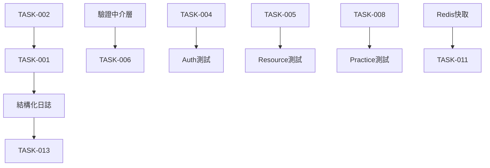

# 服務層改進任務清單

基於 Code Review 結果，整理出以下具體可執行的任務清單。

## 🚨 緊急任務 (P0 - 立即處理)

### API 回應格式標準化

- [ ] **TASK-023**: 定義標準 API 回應介面
  - 檔案: `src/types/api-response.types.ts`
  - 描述: 創建 ApiResponse<T>、PaginatedApiResponse<T>、CursorPaginatedApiResponse<T> 介面
  - 理由: 目前有 6 種不同分頁格式，需要統一標準
  - 預估: 2 小時
  - 負責人: ___________

- [ ] **TASK-024**: 創建回應工具函數
  - 檔案: `src/utils/response-helper.ts`
  - 描述: 實作 createSuccessResponse、createErrorResponse、createPaginatedResponse 等工具函數
  - 理由: 避免重複程式碼，確保回應格式一致性
  - 預估: 3 小時
  - 負責人: ___________

- [ ] **TASK-025**: 統一錯誤處理格式
  - 影響: 所有服務檔案
  - 描述: 統一使用結構化錯誤類，建立標準錯誤回應格式
  - 理由: 目前 38 個文件使用標準錯誤，27 個文件使用一般錯誤，格式不統一
  - 預估: 4 小時
  - 負責人: ___________

### 安全性修復

- [ ] **TASK-001**: 移除 JWT 服務中的敏感資訊日誌
  - 檔案: `src/services/jwt.service.ts`
  - 行數: 68, 72
  - 描述: 移除 console.log 輸出 token 和解碼資訊
  - 預估: 30 分鐘
  - 負責人: ___________

- [ ] **TASK-002**: 統一 JWT 環境變數名稱
  - 檔案: `src/services/jwt.service.ts`
  - 行數: 33
  - 描述: 移除 JWT_SECURITY，統一使用 JWT_SECRET
  - 預估: 30 分鐘
  - 負責人: ___________

- [ ] **TASK-003**: 實作 R2 檔案權限控制
  - 檔案: `src/services/r2.service.ts`
  - 行數: 55
  - 描述: 根據檔案類型設定不同 ACL，非公開檔案使用簽名 URL
  - 預估: 2 小時
  - 負責人: ___________

## 🔧 高優先級任務 (P1 - 本週完成)

### 服務回應格式遷移

- [ ] **TASK-026**: 遷移 UserService 回應格式
  - 檔案: `src/services/user.service.ts`
  - 描述: 統一使用標準 PaginatedApiResponse<T> 格式
  - 理由: 核心服務，目前格式混亂，優先處理
  - 預估: 3 小時
  - 負責人: ___________

- [ ] **TASK-027**: 遷移 ResourceService 回應格式
  - 檔案: `src/services/resource.service.ts`
  - 描述: 保留游標分頁但增加 success 包裝，使用 CursorPaginatedApiResponse<T>
  - 理由: 高性能游標分頁，只需包裝標準化
  - 預估: 2 小時
  - 負責人: ___________

- [ ] **TASK-028**: 遷移 CommentService 回應格式
  - 檔案: `src/services/comment.service.ts`
  - 描述: 改用標準 ApiResponse<T> 格式，統一錯誤處理
  - 理由: 評論系統需要統一格式
  - 預估: 2 小時
  - 負責人: ___________

- [ ] **TASK-029**: 遷移 AuthService 回應格式
  - 檔案: `src/services/auth/auth.service.ts`
  - 描述: 包裝為標準 ApiResponse<T> 格式
  - 理由: 認證核心，需要標準錯誤處理
  - 預估: 2 小時
  - 負責人: ___________

- [ ] **TASK-030**: 遷移其他 ServiceResult 格式服務
  - 影響: ReviewService, MentorService, NoteService, OutcomeService, MilestoneService, ProjectService
  - 描述: 統一改為 ApiResponse<T> 格式
  - 理由: 保持一致性，便於前端處理
  - 預估: 6 小時
  - 負責人: ___________

### 資料一致性

- [ ] **TASK-004**: Practice 服務加入事務處理
  - 檔案: `src/services/practice.service.ts`
  - 方法: `create()`, `update()`
  - 描述: 使用 Prisma transaction 包裝多步驟操作
  - 預估: 2 小時
  - 負責人: ___________

- [ ] **TASK-005**: Resource 服務加入事務處理
  - 檔案: `src/services/resource.service.ts`
  - 方法: `createResource()`, `updateResource()`
  - 描述: 確保資源和標籤操作的原子性
  - 預估: 2 小時
  - 負責人: ___________

### 輸入驗證

- [ ] **TASK-006**: Auth 服務加入 email 驗證
  - 檔案: `src/services/auth/auth.service.ts`
  - 方法: `findUserByEmail()`
  - 描述: 使用 Zod schema 驗證 email 格式
  - 預估: 1 小時
  - 負責人: ___________

- [ ] **TASK-007**: 建立統一輸入驗證中介層
  - 位置: `src/middleware/validation.ts`
  - 描述: 為所有服務方法建立驗證裝飾器
  - 預估: 4 小時
  - 負責人: ___________

### 程式碼重構

- [ ] **TASK-008**: 重構 Practice 統計查詢方法
  - 檔案: `src/services/practice.service.ts`
  - 行數: 712-838
  - 描述: 抽象 5 個相似方法為通用方法
  - 預估: 3 小時
  - 負責人: ___________

- [ ] **TASK-009**: 統一錯誤處理策略
  - 影響: 所有服務檔案
  - 描述: 建立錯誤處理規範，區分關鍵/非關鍵錯誤
  - 預估: 4 小時
  - 負責人: ___________

## 📈 中優先級任務 (P2 - 兩週內完成)

### 效能優化

- [ ] **TASK-010**: 實作 Redis 快取層
  - 影響: `resource.service.ts`, `practice.service.ts`
  - 描述: 為熱門資源和實踐列表加入快取
  - 預估: 1 天
  - 負責人: ___________

- [ ] **TASK-011**: 優化資源標籤查詢
  - 檔案: `src/services/resource.service.ts`
  - 行數: 94-102, 381-391
  - 描述: 改用 Prisma 查詢建構器替代原生 SQL
  - 預估: 3 小時
  - 負責人: ___________

### 日誌改進

- [ ] **TASK-012**: 實作結構化日誌
  - 檔案: `src/services/logging/logger.service.ts`
  - 描述: 統一日誌格式，加入請求追蹤 ID
  - 預估: 4 小時
  - 負責人: ___________

- [ ] **TASK-013**: 移除所有除錯用 console.log
  - 影響: 所有服務檔案
  - 描述: 全面檢查並移除或改用 logger
  - 預估: 2 小時
  - 負責人: ___________

### 檔案上傳安全

- [ ] **TASK-014**: 加入檔案類型驗證
  - 檔案: `src/services/r2.service.ts`
  - 描述: 白名單機制，限制可上傳的檔案類型
  - 預估: 2 小時
  - 負責人: ___________

- [ ] **TASK-015**: 實作檔案大小限制
  - 檔案: `src/services/r2.service.ts`
  - 描述: 根據檔案類型設定不同大小限制
  - 預估: 1 小時
  - 負責人: ___________

## 📊 低優先級任務 (P3 - 月度計劃)

### 測試覆蓋

- [ ] **TASK-016**: Auth 服務單元測試
  - 檔案: `src/services/auth/__tests__/auth.service.test.ts`
  - 目標覆蓋率: 80%
  - 預估: 1 天
  - 負責人: ___________

- [ ] **TASK-017**: Resource 服務單元測試
  - 檔案: `src/services/__tests__/resource.service.test.ts`
  - 目標覆蓋率: 80%
  - 預估: 1 天
  - 負責人: ___________

- [ ] **TASK-018**: Practice 服務單元測試
  - 檔案: `src/services/__tests__/practice.service.test.ts`
  - 目標覆蓋率: 80%
  - 預估: 1 天
  - 負責人: ___________

### 文件完善

- [ ] **TASK-019**: 服務層 API 文件
  - 位置: `docs/api/services/`
  - 描述: 為每個服務編寫詳細 API 文件
  - 預估: 2 天
  - 負責人: ___________

- [ ] **TASK-020**: 服務使用範例
  - 位置: `examples/services/`
  - 描述: 提供常見使用場景的程式碼範例
  - 預估: 1 天
  - 負責人: ___________

### 程式碼品質

- [ ] **TASK-021**: 抽取魔術數字為常數
  - 影響: 所有服務檔案
  - 描述: 建立 constants 檔案集中管理
  - 預估: 2 小時
  - 負責人: ___________

- [ ] **TASK-022**: 實作 DataLoader 模式
  - 影響: `resource.service.ts`
  - 描述: 解決潛在 N+1 查詢問題
  - 預估: 4 小時
  - 負責人: ___________

## 📋 檢查清單模板

每個任務完成時，請確認以下項目：

```
### 任務編號: TASK-XXX
- [ ] 程式碼已修改
- [ ] 單元測試已更新/新增
- [ ] 相關文件已更新
- [ ] Code Review 已通過
- [ ] 無新的 ESLint 警告
- [ ] 無新的 TypeScript 錯誤
- [ ] 已在開發環境測試
- [ ] 已在測試環境驗證
```

## 進度追蹤

### Week 1 (當前週)
- [ ] P0 任務完成率: ____%
- [ ] P1 任務啟動率: ____%

### Week 2
- [ ] P1 任務完成率: ____%
- [ ] P2 任務啟動率: ____%

### Week 3-4
- [ ] P2 任務完成率: ____%
- [ ] P3 任務啟動率: ____%

## 任務分配建議

### 資深工程師
- TASK-004, TASK-005 (事務處理)
- TASK-008 (重構)
- TASK-010 (快取實作)
- TASK-022 (DataLoader)

### 中級工程師
- TASK-001, TASK-002 (安全修復)
- TASK-006, TASK-007 (輸入驗證)
- TASK-011 (查詢優化)
- TASK-016, TASK-017, TASK-018 (測試)

### 初級工程師
- TASK-013 (移除 console.log)
- TASK-014, TASK-015 (檔案驗證)
- TASK-019, TASK-020 (文件)
- TASK-021 (常數抽取)

## 任務相依性



## 風險評估

### 高風險任務
- **TASK-004, TASK-005**: 事務處理可能影響現有功能
  - 緩解: 完整測試覆蓋，灰度發布

- **TASK-010**: 快取實作可能造成資料不一致
  - 緩解: 設定合理 TTL，實作快取失效機制

### 中風險任務
- **TASK-008**: 重構可能引入新 bug
  - 緩解: 先寫測試，小步重構

- **TASK-009**: 錯誤處理改變可能影響前端
  - 緩解: 與前端團隊溝通，保持向後相容

## 成功指標

- 安全漏洞修復率: 100%
- 程式碼覆蓋率提升: 60% → 80%
- 效能提升: API 回應時間降低 30%
- 錯誤率降低: 生產環境錯誤減少 50%

## 定期審查

- 每日: P0 任務進度
- 每週: 整體進度審查會議
- 每兩週: 程式碼品質評估
- 每月: 安全性審計

---

**最後更新**: 2025-08-11  
**下次審查**: 2025-08-18  
**負責人**: ___________