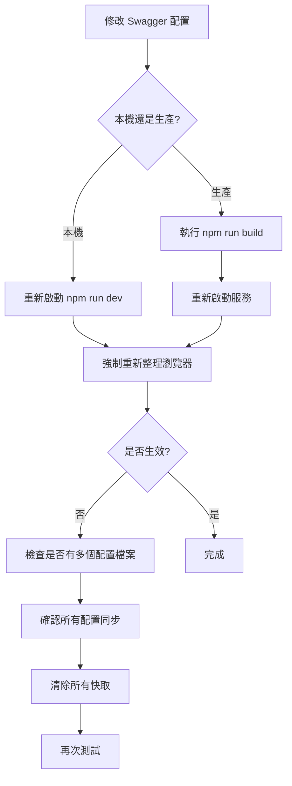

# Swagger 配置更新後未生效問題診斷指南

## 問題描述
修改了 Swagger 配置檔案，但 Swagger UI 仍顯示舊的配置（如 `http://localhost:4000`）。

## 可能原因與解決方案

### 1. 服務未重新啟動

**原因**：Node.js 服務需要重新啟動才能載入新的配置。

**解決方法**：
```bash
# 本機開發
# 停止服務 (Ctrl+C) 然後重新啟動
npm run dev

# 生產環境
# 重新啟動服務（具體命令依據您的部署方式）
pm2 restart daodao-server  # 如果使用 PM2
systemctl restart daodao-server  # 如果使用 systemd
```

### 2. 瀏覽器快取

**原因**：瀏覽器可能快取了舊的 Swagger UI 頁面。

**解決方法**：
- 強制重新整理頁面：`Ctrl + F5` (Windows) 或 `Cmd + Shift + R` (Mac)
- 開啟無痕/私密瀏覽視窗測試
- 清除瀏覽器快取
- 在開發者工具中停用快取：
  1. 開啟 F12 開發者工具
  2. Network 標籤
  3. 勾選 "Disable cache"

### 3. 配置檔案重複

**原因**：專案中有多個 Swagger 配置，後載入的覆蓋了前面的。

**在您的專案中發現**：
- `src/config/swagger.config.ts` - TypeScript 配置
- `index.js` 中的 swaggerOptions - JavaScript 配置

**解決方法**：
確保兩處配置同步，或只使用一處配置：

```javascript
// index.js - 確保這裡的配置與 TypeScript 配置一致
const swaggerOptions = {
  definition: {
    servers: [
      {
        url: 'https://server.daoedu.tw/',
        description: '開發環境'
      },
      {
        url: 'https://dao-server.daoedu.tw/',
        description: '生產環境'
      }
    ]
  }
};
```

### 4. CDN 或反向代理快取

**原因**：如果使用 CDN 或反向代理（如 Nginx），可能有快取。

**解決方法**：
- 清除 CDN 快取
- 重新載入 Nginx 配置：`nginx -s reload`
- 檢查 Nginx 配置中的快取設定

### 5. TypeScript 編譯問題

**原因**：如果使用編譯後的 JavaScript，可能編譯未更新。

**解決方法**：
```bash
# 重新編譯 TypeScript
npm run build

# 確認編譯後的檔案已更新
ls -la dist/src/config/
```

### 6. 環境變數覆蓋

**原因**：可能有環境變數覆蓋了配置。

**檢查方法**：
```bash
# 查看環境變數
echo $API_URL
echo $SWAGGER_HOST
```

## 快速診斷步驟

1. **檢查服務日誌**
   ```bash
   # 查看啟動日誌，確認載入的配置
   npm run dev
   ```

2. **驗證配置檔案**
   ```bash
   # 確認配置檔案內容
   cat src/config/swagger.config.ts | grep -A5 "servers"
   cat index.js | grep -A5 "servers"
   ```

3. **測試 API 直接回應**
   ```bash
   # 直接訪問 Swagger JSON
   curl https://server.daoedu.tw/api-docs.json
   ```

4. **檢查網路面板**
   - 開啟 F12 開發者工具
   - Network 標籤
   - 重新整理頁面
   - 查看 swagger 相關請求的回應內容

## 建議的除錯流程



## 永久解決方案

### 1. 統一配置來源
建議只在一處管理 Swagger 配置：

```javascript
// index.js
// 直接使用 TypeScript 配置
const { swaggerSpec } = require('./dist/src/config/swagger.config');
app.use('/api-docs', swaggerUi.serve, swaggerUi.setup(swaggerSpec));
```

### 2. 添加配置驗證
在啟動時列印當前配置：

```javascript
console.log('當前 Swagger 服務器配置：', 
  JSON.stringify(swaggerSpec.servers, null, 2));
```

### 3. 使用環境變數
讓配置更靈活：

```javascript
const servers = [
  {
    url: process.env.API_URL || 'https://server.daoedu.tw/',
    description: process.env.API_ENV || '開發環境'
  }
];
```

## 總結

最常見的原因是：
1. **服務未重新啟動** - 最常見
2. **瀏覽器快取** - 第二常見
3. **多個配置檔案衝突** - 在您的專案中存在

建議按照上述步驟逐一排查，通常重新啟動服務 + 強制重新整理瀏覽器就能解決問題。