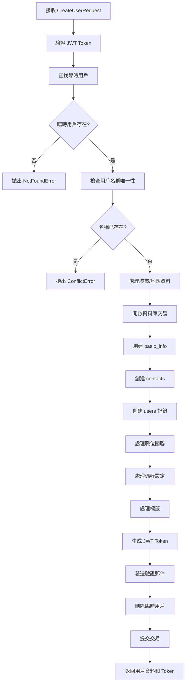
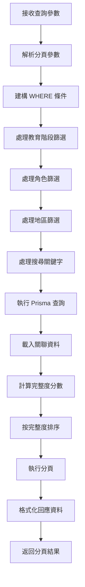

# 用戶服務架構文件

## 概述

用戶服務是 DaoDao 學習平台的核心模組，負責處理用戶註冊、認證、資料管理等功能。採用現代 TypeScript 架構，使用 Prisma ORM 與 PostgreSQL 資料庫。

**最後更新**: 2025-01-01  
**版本**: v1.2.0  
**服務路徑**: `src/services/user.service.ts`  
**控制器路徑**: `src/controllers/user.controller.ts`

## 資料庫架構

### 主要資料表

用戶資料採用**關聯式設計**，主要涉及以下表：

```
users (主表)
├── contacts (聯絡資訊)
├── basic_info (基本資訊)  
├── location (地理位置)
├── user_positions (職位關聯)
├── user_preferences (偏好設定)
└── entity_tags (標籤系統)
```

### 核心欄位說明

**users 表**：
- `id`: 內部數字ID (主鍵)
- `external_id`: 對外UUID (用於API，防止ID列舉攻擊)
- `mongo_id`: 舊系統相容ID
- `nickname`: 用戶暱稱
- `gender`: 性別 (male/female/other)
- `education_stage`: 教育階段 (university/high/other)
- `is_open_location`: 是否公開位置
- `is_open_profile`: 是否公開個人資料
- `birth_date`: 生日
- `custom_id`: 自訂 ID (唯一，可為空)
- `custom_id_verified`: 自訂 ID 驗證狀態
- `custom_id_created_at`: 自訂 ID 創建時間
- `role_id`: 角色ID (關聯 roles 表)
- `location_id`: 位置ID (關聯 location 表)
- `contact_id`: 聯絡資訊ID (關聯 contacts 表)
- `basic_info_id`: 基本資訊ID (關聯 basic_info 表)

**contacts 表**：
- `email`: 電子郵件
- `google_id`: Google OAuth ID
- `photo_url`: 頭像URL
- `is_subscribe_email`: 是否訂閱郵件
- `ig`, `discord`, `line`, `fb`: 社交媒體帳號

**basic_info 表**：
- `self_introduction`: 自我介紹
- `share_list`: 分享內容
- `want_to_do_list`: 想做事項列表 (JSON Array)

**entity_tags 表**：
- `entity_type`: 實體類型 ('user', 'resource', 'project' 等)
- `entity_id`: 實體ID
- `tag_id`: 標籤ID
- `created_by`: 創建者ID

## API 路由結構

### 端點列表

| 方法 | 路徑 | 描述 | 權限 |
|------|------|------|------|
| GET | `/api/users` | 獲取用戶列表 | 可選認證 |
| GET | `/api/users/me` | 獲取當前用戶資訊 | 需要認證 |
| GET | `/api/users/:id` | 獲取指定用戶資訊 | 無 |
| POST | `/api/users` | 創建新用戶 | 需要認證 |
| PUT | `/api/users/:id` | 更新用戶資訊 | 需要認證 + 權限 |
| DELETE | `/api/users/me` | 刪除當前用戶 | 需要認證 |
| DELETE | `/api/users/:id` | 刪除指定用戶 | 管理員權限 |
| GET | `/api/users/custom-id/check/:customId` | 檢查自訂 ID 可用性 | 無 |
| GET | `/api/users/custom-id/:customId` | 透過自訂 ID 獲取用戶 | 無 |
| POST | `/api/users/me/custom-id` | 設置當前用戶自訂 ID | 需要認證 |
| DELETE | `/api/users/me/custom-id` | 移除當前用戶自訂 ID | 需要認證 |

### 查詢參數 (GET /api/users)

- `page`: 頁碼 (預設: 1)
- `pageSize`: 每頁大小 (預設: 10)
- `educationStage`: 教育階段篩選 (逗號分隔)
- `roleList`: 角色篩選 (逗號分隔)
- `location`: 地區篩選 (逗號分隔)
- `search`: 關鍵字搜尋 (搜尋暱稱、自介、分享內容)

## 主要業務流程

### 1. 用戶創建流程



#### 詳細步驟說明

1. **驗證與準備**
   - 驗證 JWT token 有效性
   - 從 token 取得臨時用戶 ID
   - 查找對應的臨時用戶記錄

2. **資料驗證**
   - 檢查用戶名稱唯一性
   - 驗證城市名稱並轉換為枚舉值
   - 驗證 want_to_do_list 項目

3. **資料庫操作 (交易)**
   - 創建基本資訊記錄
   - 創建聯絡資訊記錄
   - 創建用戶主記錄
   - 建立職位關聯
   - 設定偏好選項
   - 處理標籤關聯

4. **後續處理**
   - 生成新的 JWT token
   - 發送註冊驗證郵件
   - 清理臨時用戶記錄

### 2. 用戶查詢流程



### 3. 完整度計算演算法

用戶完整度分數用於在列表中優先顯示資料較完整的用戶：

```typescript
完整度分數 = 
  自我介紹分數 + 
  分享內容分數 + 
  標籤分數 + 
  聯絡方式分數 + 
  地理位置分數 + 
  職位資訊分數
```

#### 計分規則

1. **自我介紹分數** (base: 2, 依字數分級)
   - 50字以下: 2分
   - 51-100字: 4分
   - 101-200字: 6分
   - 201-300字: 8分
   - 300字以上: 8分

2. **分享內容分數** (base: 2, 依字數分級)
   - 規則同自我介紹

3. **標籤分數**
   - 每個標籤 0.5分，最高 4分

4. **其他項目**
   - 聯絡方式: 1分 (有任何額外聯絡方式)
   - 地理位置: 1分 (有設定城市)
   - 職位資訊: 1分 (有設定職位)

## 型別定義

### 主要介面

#### CreateUserRequest
用戶創建請求的資料結構：

```typescript
interface CreateUserRequest {
  gender?: string;                          // 性別
  birthDate?: Date | string;               // 生日
  contactList?: {                          // 聯絡方式
    instagram?: string;
    discord?: string;
    line?: string;
    facebook?: string;
  };
  educationStage?: string;                 // 教育階段
  isOpenLocation?: boolean;                // 是否公開位置
  isOpenProfile?: boolean;                 // 是否公開個人資料
  isSubscribeEmail?: boolean;              // 是否訂閱郵件
  location?: string;                       // 城市代碼
  roleList?: string[];                     // 職位列表
  selfIntroduction?: string;               // 自我介紹
  share?: string | string[];               // 分享內容
  wantToDoList?: string[];                // 想做事項
  tagList?: string[];                      // 標籤列表
  preferences?: Record<string, string[]>;  // 偏好設定
  isSendEmail?: boolean;                   // 是否發送郵件
}
```

#### FormattedUserResponse
格式化後的用戶回應資料：

```typescript
interface FormattedUserResponse {
  id: number;                              // 內部ID
  _id: string;                            // 外部UUID
  name?: string;                          // 暱稱
  gender?: string;                        // 性別
  email?: string;                         // 郵件
  photoURL?: string;                      // 頭像URL
  birthDay?: Date | string;               // 生日
  isOpenLocation?: boolean;               // 是否公開位置
  isOpenProfile?: boolean;                // 是否公開個人資料
  role?: number;                          // 角色ID
  location?: string;                      // 城市名稱
  tagList?: string[];                     // 標籤列表
  wantToDoList?: string[];               // 想做事項
  educationStage?: string;               // 教育階段
  selfIntroduction?: string;             // 自我介紹
  share?: string | string[];             // 分享內容
  preferences?: Record<string, Array<{   // 偏好設定
    name: string; 
    value: string;
  }>>;
  contactList?: {                        // 聯絡資訊
    email?: string;
    photoUrl?: string;
    isSubscribeEmail?: boolean;
    instagram?: string;
    discord?: string;
    line?: string;
    facebook?: string;
  };
  basicInfo?: {                          // 基本資訊
    selfIntroduction?: string;
    shareList?: string | string[];
    wantToDoList?: string[];
  };
  roleList?: string[];                   // 職位名稱列表
  customId?: string;                     // 自訂 ID
  customIdVerified?: boolean;            // 自訂 ID 驗證狀態
  customIdCreatedAt?: string;            // 自訂 ID 創建時間
  createdDate?: string;                  // 創建時間
  updatedDate?: string;                  // 更新時間
}
```

## 特色功能

### 1. 自訂 ID 系統

支援用戶設置個人化的自訂 ID，可用於創建個人化的用戶資料頁面 URL：

#### 基本規則
- **唯一性**: 每個自訂 ID 在系統中必須唯一，不可重複
- **長度限制**: 最少 3 個字符，最多 50 個字符
- **字符限制**: 只能包含：
  - 英文字母 (a-z, A-Z)
  - 數字 (0-9)
  - 底線 (_)
  - 連字符 (-)
- **開頭/結尾限制**: 不能以底線 (_) 或連字符 (-) 開頭或結尾
- **大小寫敏感**: 區分大小寫 (userId 與 UserId 視為不同)

#### 設置規則
- **單一設置**: 每個用戶同時只能擁有一個自訂 ID
- **修改限制**: 已設置自訂 ID 的用戶必須先移除現有 ID 才能設置新的
- **即時生效**: 設置成功後立即生效，可透過自訂 ID 存取用戶資料
- **驗證狀態**: 系統會記錄驗證狀態 (`custom_id_verified`) 和創建時間

#### 有效範例
```
✅ john-doe
✅ user_123
✅ JohnDoe2024
✅ my-awesome-profile
✅ dev_engineer_01
```

#### 無效範例
```
❌ jo (太短，少於 3 個字符)
❌ -john-doe (以連字符開頭)
❌ john_doe_ (以底線結尾)
❌ john@doe (包含不允許的字符 @)
❌ 用戶123 (包含中文字符)
❌ john doe (包含空格)
```

#### API 使用範例
```typescript
// 檢查自訂 ID 可用性
const availability = await userService.checkCustomIdAvailability('my-custom-id');
// 回傳: { available: true/false }

// 設置自訂 ID
await userService.setCustomId(userId, 'my-custom-id');
// 回傳: { customId: 'my-custom-id' }

// 透過自訂 ID 查詢用戶
const user = await userService.getUserByCustomId('my-custom-id');
// 回傳: FormattedUserResponse

// 移除自訂 ID
await userService.removeCustomId(userId);
// 回傳: { message: '自訂 ID 已成功移除' }
```

#### 錯誤處理
- **格式錯誤**: 返回 400 Bad Request 和詳細的格式錯誤訊息
- **ID 已存在**: 返回 409 Conflict「此自訂 ID 已被使用」
- **重複設置**: 返回 409 Conflict「用戶已設置自訂 ID，請先移除現有 ID」
- **用戶不存在**: 返回 404 Not Found

#### 應用場景
1. **個人化 URL**: `/users/custom-id/john-doe` 替代 `/users/550e8400-e29b-41d4-a716-446655440000`
2. **社交分享**: 更易記憶和分享的用戶資料連結
3. **品牌建立**: 用戶可建立一致的線上身份識別
4. **SEO 優化**: 友善的 URL 結構有助於搜尋引擎優化

### 2. 標籤系統

採用通用的 `entity_tags` 表設計，支援多種實體類型：

- **實體類型**: `user`, `resource`, `project`, `practice` 等
- **統一管理**: 透過 `tagService` 進行 CRUD 操作
- **關聯查詢**: 支援依標籤篩選用戶
- **交易支援**: 標籤操作在用戶創建/更新交易中執行

```typescript
// 設定用戶標籤 (在交易中執行)
await tagService.setEntityTags('user', userId, ['JavaScript', 'React'], creatorId, tx);

// 獲取用戶標籤
const tags = await tagService.getEntityTags('user', userId);
```

### 3. 城市映射系統

支援中文城市名稱自動轉換為資料庫枚舉值：

```typescript
const getCityNameMapping = (): Record<string, city_t> => {
  return {
    '台北市': 'taipei_city',
    '新北市': 'new_taipei_city',
    '桃園市': 'taoyuan_city',
    '台中市': 'taichung_city',
    '台南市': 'tainan_city',
    '高雄市': 'kaohsiung_city',
    // ... 更多城市
    'online': 'online',
    'other': 'other'
  };
};
```

### 4. 偏好設定系統

支援多維度的用戶偏好，基於 `preference_types` 和 `preference_options` 表：

```typescript
// 偏好設定範例
preferences: {
  "learning_style": ["visual", "audio"],     // 學習風格
  "time_preference": ["morning", "evening"], // 時間偏好
  "difficulty_level": ["beginner"]           // 難度偏好
}

// 處理偏好設定（在交易中執行）
await handleUserPreferences(userId, preferences, tx);
```

### 5. Want-to-Do 列表驗證

安全地處理和驗證用戶的待辦事項列表：

```typescript
// 驗證 want_to_do_list 項目
const validateWantToDoList = (items: unknown[]): want_to_do_list_t[] => {
  return items.filter((item): item is want_to_do_list_t => {
    const isValid = isValidWantToDoItem(item);
    if (!isValid && item !== null && item !== undefined) {
      console.warn(`Invalid want_to_do_list item: ${item}`);
    }
    return isValid;
  });
};
```

### 6. 權限控制

基於角色和資源擁有者的權限系統：

- **自己修改**: 用戶可以修改自己的資料
- **管理員操作**: 管理員可以操作所有用戶
- **創建權限**: 僅臨時用戶可以創建正式用戶（通過 `canCreateUser()` 中介軟體）
- **更新權限**: 通過 `canUpdateUser()` 中介軟體驗證

## 安全特性

### 1. 防 ID 列舉攻擊
- 使用 UUID `external_id` 對外，避免順序數字 ID

### 2. JWT 認證
- 基於 JWT token 的身份認證
- Token 包含用戶 ID 和臨時狀態

### 3. 輸入驗證
- 使用 Zod schemas 進行嚴格的型別檢查
- 防止 SQL 注入和 XSS 攻擊

### 4. 敏感資料保護
- 密碼等敏感資料不存於此服務
- 郵件地址等 PII 資料適當保護

### 5. 交易支援
- 關鍵操作使用資料庫交易確保資料一致性
- 失敗時自動回滾

## 錯誤處理

### 常見錯誤類型

1. **NotFoundError**: 用戶不存在
2. **ConflictError**: 用戶名稱衝突、城市無效等
3. **ValidationError**: 輸入資料格式錯誤
4. **AuthenticationError**: 認證失敗
5. **PermissionError**: 權限不足

### 錯誤回應格式

```typescript
{
  success: false,
  message: "錯誤描述",
  error: "ERROR_CODE",
  details?: "詳細錯誤資訊"
}
```

## 效能考量

### 1. 資料庫索引
- `external_id` 唯一索引
- `email` 索引 (用於搜尋)
- `is_open_profile` 索引 (用於公開用戶查詢)

### 2. 查詢最佳化
- 使用 Prisma 的 `include` 精確載入需要的關聯資料
- 分頁查詢避免大量資料載入

### 3. 完整度計算
- 在記憶體中計算，避免複雜的 SQL 聚合查詢
- 可考慮快取完整度分數以提升效能

## 測試覆蓋

目前測試涵蓋：
- ✅ API 集成測試 (22個測試用例)
- ✅ 服務層單元測試 (34個測試用例)  
- ✅ 控制器單元測試 (18個測試用例)
- ✅ 驗證器測試

測試覆蓋了主要的業務邏輯、邊界條件和錯誤情況。

## 未來擴展

### 1. 快取系統
- Redis 快取用戶基本資料
- 快取完整度分數

### 2. 搜尋優化
- Elasticsearch 全文檢索
- 支援更複雜的搜尋條件

### 3. 資料分析
- 用戶行為追蹤
- 完整度分析報表

### 4. 國際化
- 多語言城市名稱支援
- 本地化錯誤訊息

## 服務方法詳解

### 核心 CRUD 操作

#### `getAllUsers(params: UserQueryParams)`
- **功能**: 獲取用戶列表，支援分頁、篩選和搜尋
- **特色**: 按完整度分數排序，優先顯示資料完整的用戶
- **權限**: 僅返回 `is_open_profile: true` 的用戶

#### `getMe(externalId: string)`
- **功能**: 獲取當前用戶完整資訊
- **驗證**: UUID 格式驗證
- **回傳**: `FormattedUserResponse` 或 `null`

#### `createUser(userData: CreateUserRequest, tempUserId: string)`
- **功能**: 從臨時用戶轉換為正式用戶
- **交易**: 完整的資料庫交易操作
- **流程**: 驗證 → 創建關聯資料 → 處理標籤/偏好 → 發送郵件

#### `updateUser(externalId: string, userData: UpdateUserRequest)`
- **功能**: 更新用戶資訊
- **交易**: 確保資料一致性
- **支援**: 聯絡資訊、基本資訊、職位、標籤等全面更新

#### `deleteMe(externalId: string)` 和 `deleteUser(userId: number)`
- **功能**: 刪除用戶及所有關聯資料
- **交易**: 級聯刪除所有相關記錄
- **權限**: `deleteMe` 需認證，`deleteUser` 需管理員權限

### 自訂 ID 相關操作

#### `checkCustomIdAvailability(customId: string)`
- **功能**: 檢查自訂 ID 是否可用
- **驗證**: 格式檢查 + 唯一性檢查
- **回傳**: `{ available: boolean }`

#### `setCustomId(userId: number, customId: string)`
- **功能**: 設置用戶自訂 ID
- **保護**: 防止重複設置、格式驗證
- **交易**: 確保唯一性約束

#### `getUserByCustomId(customId: string)`
- **功能**: 透過自訂 ID 查詢用戶
- **用途**: 支援個人化 URL 訪問

#### `removeCustomId(userId: number)`
- **功能**: 移除用戶自訂 ID
- **效果**: 重置相關欄位為 `null`

## 資料處理工具函數

### `formatUserResponse(user: PrismaUserWithRelations)`
- **功能**: 將 Prisma 查詢結果轉換為 API 回應格式
- **處理**: 時間格式化、標籤載入、偏好設定整理
- **輸出**: 標準化的 `FormattedUserResponse`

### `handleUserPreferences(userId, preferences, tx)`
- **功能**: 處理用戶偏好設定
- **策略**: 先刪除後新增，確保資料準確性
- **交易**: 在主交易內執行

### `validateWantToDoList(items: unknown[])`
- **功能**: 驗證和過濾 want_to_do_list 項目
- **安全**: 防止無效資料寫入資料庫
- **記錄**: 無效項目會產生警告日誌

### `calculateScore(length: number, config)`
- **功能**: 根據內容長度計算完整度分數
- **配置**: 支援多級計分規則
- **用途**: 用戶完整度排序

## 驗證和中介軟體

### Zod 驗證 Schemas

#### `createUserSchema` (src/validators/user.validators.ts)
```typescript
// 支援的欄位驗證
gender: z.enum(['male', 'female', 'other']).optional()
educationStage: z.enum(['university', 'high', 'other']).optional()
contactList: { instagram, discord, line, facebook }
// ... 其他欄位
```

#### `updateUserSchema`
```typescript
// 更新時的欄位驗證
name: z.string().optional()
email: z.string().email().optional()
photoUrl: z.string().url().optional()
// ... 其他欄位
```

#### `customIdSchema` (src/validators/user-custom-id.validators.ts)
```typescript
customId: z.string()
  .min(3, '自訂 ID 至少需要 3 個字符')
  .max(50, '自訂 ID 不能超過 50 個字符')
  .regex(/^[a-zA-Z0-9_-]+$/, '只能包含英文字母、數字、底線和連字符')
  .refine(val => !val.startsWith('_') && !val.startsWith('-'), '不能以底線或連字符開頭')
  .refine(val => !val.endsWith('_') && !val.endsWith('-'), '不能以底線或連字符結尾')
```

### 權限中介軟體

#### `canCreateUser()` (src/middleware/permission.middleware.ts)
- **邏輯**: 僅允許臨時用戶創建正式用戶
- **檢查**: `req.user.isTemp === true`

#### `canUpdateUser()`
- **邏輯**: 用戶只能更新自己的資料，或管理員可更新任何用戶
- **檢查**: 路徑參數與當前用戶 ID 比對

#### `requireAdmin`
- **邏輯**: 僅管理員可執行操作
- **檢查**: 用戶角色權限

## 錯誤處理機制

### Prisma 錯誤處理
```typescript
// 唯一約束違反處理
if (error && typeof error === 'object' && 'code' in error) {
  const prismaError = error as { code: string; meta?: { target?: string[] } };
  if (prismaError.code === 'P2002' && prismaError.meta?.target?.includes('custom_id')) {
    throw new ConflictError('此自訂 ID 已被其他用戶使用');
  }
}
```

### 自訂錯誤類型
- **NotFoundError**: 用戶不存在、臨時用戶未找到
- **ConflictError**: 用戶名稱衝突、自訂 ID 已存在、城市無效
- **ValidationError**: Zod 驗證失敗時自動產生

## 效能最佳化

### 查詢最佳化
1. **精確載入**: 使用 Prisma `include` 只載入需要的關聯資料
2. **索引使用**: `external_id`、`custom_id`、`email` 等關鍵欄位建立索引
3. **分頁查詢**: 避免載入過多資料，支援自訂頁面大小

### 記憶體最佳化
1. **完整度計算**: 在應用層計算，避免複雜的 SQL 聚合查詢
2. **資料轉換**: 延遲載入標籤資訊，只在需要時查詢
3. **交易管理**: 適當的交易範圍，避免長時間鎖定

### 快取建議
1. **用戶基本資料**: Redis 快取常用用戶資訊
2. **完整度分數**: 快取計算結果，定期更新
3. **城市映射**: 記憶體快取映射表
4. **偏好選項**: 快取 preference_types 和 preference_options