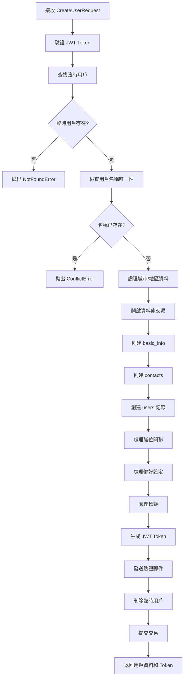
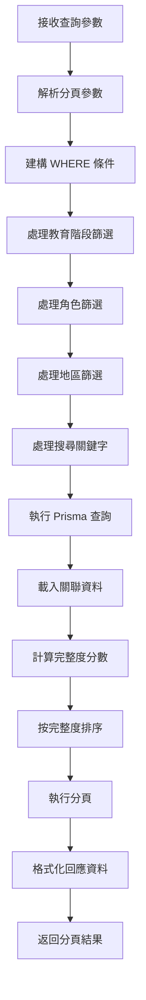

# 用戶服務架構文件

## 概述

用戶服務是 DaoDao 學習平台的核心模組，負責處理用戶註冊、認證、資料管理等功能。採用現代 TypeScript 架構，使用 Prisma ORM 與 PostgreSQL 資料庫。

## 資料庫架構

### 主要資料表

用戶資料採用**關聯式設計**，主要涉及以下表：

```
users (主表)
├── contacts (聯絡資訊)
├── basic_info (基本資訊)  
├── location (地理位置)
├── user_positions (職位關聯)
├── user_preferences (偏好設定)
└── entity_tags (標籤系統)
```

### 核心欄位說明

**users 表**：
- `id`: 內部數字ID (主鍵)
- `external_id`: 對外UUID (用於API，防止ID列舉攻擊)
- `mongo_id`: 舊系統相容ID
- `nickname`: 用戶暱稱
- `gender`: 性別 (male/female/other)
- `education_stage`: 教育階段 (university/high/other)
- `is_open_location`: 是否公開位置
- `is_open_profile`: 是否公開個人資料
- `birth_date`: 生日
- `role_id`: 角色ID (關聯 roles 表)
- `location_id`: 位置ID (關聯 location 表)
- `contact_id`: 聯絡資訊ID (關聯 contacts 表)
- `basic_info_id`: 基本資訊ID (關聯 basic_info 表)

**contacts 表**：
- `email`: 電子郵件
- `google_id`: Google OAuth ID
- `photo_url`: 頭像URL
- `is_subscribe_email`: 是否訂閱郵件
- `ig`, `discord`, `line`, `fb`: 社交媒體帳號

**basic_info 表**：
- `self_introduction`: 自我介紹
- `share_list`: 分享內容
- `want_to_do_list`: 想做事項列表 (JSON Array)

**entity_tags 表**：
- `entity_type`: 實體類型 ('user', 'resource', 'project' 等)
- `entity_id`: 實體ID
- `tag_id`: 標籤ID
- `created_by`: 創建者ID

## API 路由結構

### 端點列表

| 方法 | 路徑 | 描述 | 權限 |
|------|------|------|------|
| GET | `/api/users` | 獲取用戶列表 | 可選認證 |
| GET | `/api/users/me` | 獲取當前用戶資訊 | 需要認證 |
| GET | `/api/users/:id` | 獲取指定用戶資訊 | 無 |
| POST | `/api/users` | 創建新用戶 | 需要認證 |
| PUT | `/api/users/:id` | 更新用戶資訊 | 需要認證 + 權限 |
| DELETE | `/api/users/me` | 刪除當前用戶 | 需要認證 |
| DELETE | `/api/users/:id` | 刪除指定用戶 | 管理員權限 |

### 查詢參數 (GET /api/users)

- `page`: 頁碼 (預設: 1)
- `pageSize`: 每頁大小 (預設: 10)
- `educationStage`: 教育階段篩選 (逗號分隔)
- `roleList`: 角色篩選 (逗號分隔)
- `location`: 地區篩選 (逗號分隔)
- `search`: 關鍵字搜尋 (搜尋暱稱、自介、分享內容)

## 主要業務流程

### 1. 用戶創建流程



#### 詳細步驟說明

1. **驗證與準備**
   - 驗證 JWT token 有效性
   - 從 token 取得臨時用戶 ID
   - 查找對應的臨時用戶記錄

2. **資料驗證**
   - 檢查用戶名稱唯一性
   - 驗證城市名稱並轉換為枚舉值
   - 驗證 want_to_do_list 項目

3. **資料庫操作 (交易)**
   - 創建基本資訊記錄
   - 創建聯絡資訊記錄
   - 創建用戶主記錄
   - 建立職位關聯
   - 設定偏好選項
   - 處理標籤關聯

4. **後續處理**
   - 生成新的 JWT token
   - 發送註冊驗證郵件
   - 清理臨時用戶記錄

### 2. 用戶查詢流程



### 3. 完整度計算演算法

用戶完整度分數用於在列表中優先顯示資料較完整的用戶：

```typescript
完整度分數 = 
  自我介紹分數 + 
  分享內容分數 + 
  標籤分數 + 
  聯絡方式分數 + 
  地理位置分數 + 
  職位資訊分數
```

#### 計分規則

1. **自我介紹分數** (base: 2, 依字數分級)
   - 50字以下: 2分
   - 51-100字: 4分
   - 101-200字: 6分
   - 201-300字: 8分
   - 300字以上: 8分

2. **分享內容分數** (base: 2, 依字數分級)
   - 規則同自我介紹

3. **標籤分數**
   - 每個標籤 0.5分，最高 4分

4. **其他項目**
   - 聯絡方式: 1分 (有任何額外聯絡方式)
   - 地理位置: 1分 (有設定城市)
   - 職位資訊: 1分 (有設定職位)

## 型別定義

### 主要介面

#### CreateUserRequest
用戶創建請求的資料結構：

```typescript
interface CreateUserRequest {
  gender?: string;                          // 性別
  birthDate?: Date | string;               // 生日
  contactList?: {                          // 聯絡方式
    instagram?: string;
    discord?: string;
    line?: string;
    facebook?: string;
  };
  educationStage?: string;                 // 教育階段
  isOpenLocation?: boolean;                // 是否公開位置
  isOpenProfile?: boolean;                 // 是否公開個人資料
  isSubscribeEmail?: boolean;              // 是否訂閱郵件
  location?: string;                       // 城市代碼
  roleList?: string[];                     // 職位列表
  selfIntroduction?: string;               // 自我介紹
  share?: string | string[];               // 分享內容
  wantToDoList?: string[];                // 想做事項
  tagList?: string[];                      // 標籤列表
  preferences?: Record<string, string[]>;  // 偏好設定
  isSendEmail?: boolean;                   // 是否發送郵件
}
```

#### FormattedUserResponse
格式化後的用戶回應資料：

```typescript
interface FormattedUserResponse {
  id: number;                              // 內部ID
  _id: string;                            // 外部UUID
  name?: string;                          // 暱稱
  gender?: string;                        // 性別
  email?: string;                         // 郵件
  photoURL?: string;                      // 頭像URL
  birthDay?: Date | string;               // 生日
  isOpenLocation?: boolean;               // 是否公開位置
  isOpenProfile?: boolean;                // 是否公開個人資料
  role?: number;                          // 角色ID
  location?: string;                      // 城市名稱
  tagList?: string[];                     // 標籤列表
  wantToDoList?: string[];               // 想做事項
  educationStage?: string;               // 教育階段
  selfIntroduction?: string;             // 自我介紹
  share?: string | string[];             // 分享內容
  preferences?: Record<string, Array<{   // 偏好設定
    name: string; 
    value: string;
  }>>;
  contactList?: {                        // 聯絡資訊
    email?: string;
    photoUrl?: string;
    isSubscribeEmail?: boolean;
    instagram?: string;
    discord?: string;
    line?: string;
    facebook?: string;
  };
  roleList?: string[];                   // 職位名稱列表
  createdDate?: string;                  // 創建時間
  updatedDate?: string;                  // 更新時間
}
```

## 特色功能

### 1. 標籤系統

採用通用的 `entity_tags` 表設計，支援多種實體類型：

- **實體類型**: `user`, `resource`, `project`, `practice` 等
- **統一管理**: 透過 `tagService` 進行 CRUD 操作
- **關聯查詢**: 支援依標籤篩選用戶

```typescript
// 設定用戶標籤
await tagService.setEntityTags('user', userId, ['JavaScript', 'React'], creatorId);

// 獲取用戶標籤
const tags = await tagService.getEntityTags('user', userId);
```

### 2. 城市映射系統

支援中文城市名稱自動轉換為資料庫枚舉值：

```typescript
const cityMapping = {
  '台北市': 'taipei_city',
  '新北市': 'new_taipei_city',
  '桃園市': 'taoyuan_city',
  // ... 更多城市
};
```

### 3. 偏好設定系統

支援多維度的用戶偏好：

```typescript
// 偏好設定範例
preferences: {
  "learning_style": ["visual", "audio"],     // 學習風格
  "time_preference": ["morning", "evening"], // 時間偏好
  "difficulty_level": ["beginner"]           // 難度偏好
}
```

### 4. 權限控制

基於角色和資源擁有者的權限系統：

- **自己修改**: 用戶可以修改自己的資料
- **管理員操作**: 管理員可以操作所有用戶
- **創建權限**: 僅臨時用戶可以創建正式用戶

## 安全特性

### 1. 防 ID 列舉攻擊
- 使用 UUID `external_id` 對外，避免順序數字 ID

### 2. JWT 認證
- 基於 JWT token 的身份認證
- Token 包含用戶 ID 和臨時狀態

### 3. 輸入驗證
- 使用 Zod schemas 進行嚴格的型別檢查
- 防止 SQL 注入和 XSS 攻擊

### 4. 敏感資料保護
- 密碼等敏感資料不存於此服務
- 郵件地址等 PII 資料適當保護

### 5. 交易支援
- 關鍵操作使用資料庫交易確保資料一致性
- 失敗時自動回滾

## 錯誤處理

### 常見錯誤類型

1. **NotFoundError**: 用戶不存在
2. **ConflictError**: 用戶名稱衝突、城市無效等
3. **ValidationError**: 輸入資料格式錯誤
4. **AuthenticationError**: 認證失敗
5. **PermissionError**: 權限不足

### 錯誤回應格式

```typescript
{
  success: false,
  message: "錯誤描述",
  error: "ERROR_CODE",
  details?: "詳細錯誤資訊"
}
```

## 效能考量

### 1. 資料庫索引
- `external_id` 唯一索引
- `email` 索引 (用於搜尋)
- `is_open_profile` 索引 (用於公開用戶查詢)

### 2. 查詢最佳化
- 使用 Prisma 的 `include` 精確載入需要的關聯資料
- 分頁查詢避免大量資料載入

### 3. 完整度計算
- 在記憶體中計算，避免複雜的 SQL 聚合查詢
- 可考慮快取完整度分數以提升效能

## 測試覆蓋

目前測試涵蓋：
- ✅ API 集成測試 (22個測試用例)
- ✅ 服務層單元測試 (34個測試用例)  
- ✅ 控制器單元測試 (18個測試用例)
- ✅ 驗證器測試

測試覆蓋了主要的業務邏輯、邊界條件和錯誤情況。

## 未來擴展

### 1. 快取系統
- Redis 快取用戶基本資料
- 快取完整度分數

### 2. 搜尋優化
- Elasticsearch 全文檢索
- 支援更複雜的搜尋條件

### 3. 資料分析
- 用戶行為追蹤
- 完整度分析報表

### 4. 國際化
- 多語言城市名稱支援
- 本地化錯誤訊息