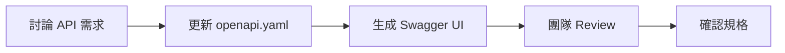
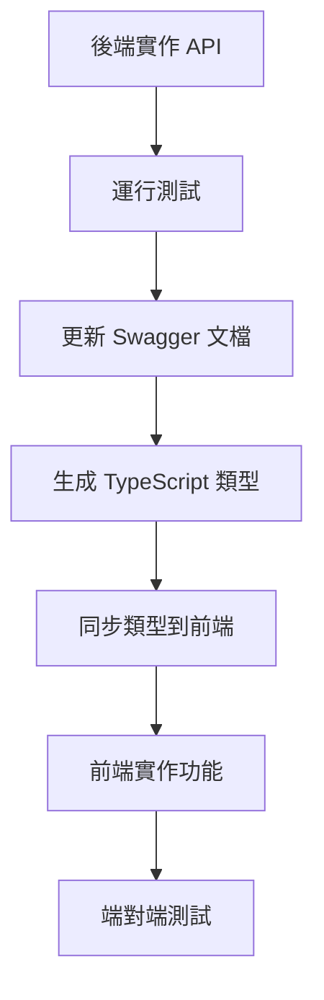
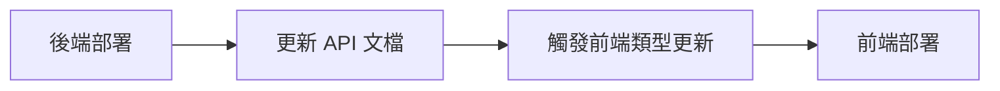

# DaoDao API 前後端協作指南

## 概述

本指南說明 DaoDao 學習平台前後端分離架構中的 API 協作方式，包含 Swagger 文檔和 OpenAPI 類型系統的使用方法。

## 專案架構

### 分離式部署
- **後端**: Node.js + Express + TypeScript (`daodao-server`)
- **前端**: 獨立 Repository，獨立部署環境
- **API 規範**: 單一來源真實 (`openapi.yaml`)

## API 文檔系統

### 1. Swagger UI (互動式文檔)

#### 用途
- 🔍 **API 探索**: 瀏覽所有可用的 API 端點
- 🧪 **互動測試**: 直接在瀏覽器中測試 API
- 📖 **文檔參考**: 查看詳細的請求/響應格式
- 🤝 **團隊溝通**: 前後端討論 API 設計的共同參考

#### 訪問方式
```
開發環境: http://localhost:3000/api-docs
生產環境: https://dao-server.daoedu.tw/api-docs
```

#### 使用場景
```javascript
// 1. 後端開發者測試新 API
// 訪問 Swagger UI → 找到端點 → 點擊 "Try it out" → 填入參數 → Execute

// 2. 前端開發者了解 API 規格
// 查看請求格式、必要參數、響應結構、錯誤碼等

// 3. 團隊 API Review
// 使用 Swagger UI 作為討論 API 設計的共同介面
```

### 2. OpenAPI TypeScript 類型

#### 用途
- ✅ **類型安全**: 編譯時期檢查 API 請求/響應類型
- 🔧 **開發體驗**: IDE 智能提示和自動完成
- 🛡️ **錯誤預防**: 避免 API 調用時的類型錯誤
- 🔄 **同步更新**: API 變更時自動同步類型定義

#### 生成方式
```bash
# 後端生成類型文件
npm run openapi:generate  # 僅生成 OpenAPI 類型
npm run types:generate     # 生成 Prisma + OpenAPI 類型

# 輸出文件
generated/openapi-types.ts
```

## 前端整合方案

### 方案一：直接使用生成的類型文件 (推薦)

#### 1. 複製類型文件
```bash
# 手動複製 (開發階段)
cp ../daodao-server/generated/openapi-types.ts ./src/types/api-types.ts

# 或通過 CI/CD 自動同步 (生產階段)
# .github/workflows/sync-types.yml
```

#### 2. 前端使用範例
```typescript
// src/types/api-types.ts
import type { components, paths } from './api-types';

// 使用 Schema 類型
type User = components['schemas']['UserProfile'];
type Resource = components['schemas']['Resource'];
type CreateResourceRequest = components['schemas']['CreateResourceRequest'];
type ResourceListResponse = components['schemas']['ResourceListResponse'];

// 使用路徑類型
type GetResourcesEndpoint = paths['/api/v1/resources']['get'];
type GetResourcesQuery = GetResourcesEndpoint['parameters']['query'];
type GetResourcesResponse = GetResourcesEndpoint['responses']['200']['content']['application/json'];
```

#### 3. API Client 實作
```typescript
// src/api/client.ts
import type { components, paths } from '../types/api-types';

class ApiClient {
  private baseURL = process.env.REACT_APP_API_URL || 'http://localhost:3000/api/v1';
  
  // 取得資源列表
  async getResources(
    params?: paths['/api/v1/resources']['get']['parameters']['query']
  ): Promise<components['schemas']['ResourceListResponse']> {
    const url = new URL(`${this.baseURL}/resources`);
    if (params) {
      Object.entries(params).forEach(([key, value]) => {
        if (value !== undefined) url.searchParams.append(key, String(value));
      });
    }
    
    const response = await fetch(url.toString());
    if (!response.ok) throw new Error('Failed to fetch resources');
    return response.json();
  }
  
  // 創建資源
  async createResource(
    data: components['schemas']['CreateResourceRequest']
  ): Promise<components['schemas']['ResourceResponse']> {
    const response = await fetch(`${this.baseURL}/resources`, {
      method: 'POST',
      headers: {
        'Content-Type': 'application/json',
        'Authorization': `Bearer ${this.getToken()}`
      },
      body: JSON.stringify(data)
    });
    
    if (!response.ok) throw new Error('Failed to create resource');
    return response.json();
  }
  
  private getToken(): string {
    return localStorage.getItem('token') || '';
  }
}

export const apiClient = new ApiClient();
```

#### 4. React Hook 整合
```typescript
// src/hooks/useResources.ts
import { useState, useEffect } from 'react';
import { apiClient } from '../api/client';
import type { components } from '../types/api-types';

type Resource = components['schemas']['Resource'];
type ResourceFilters = {
  type?: string;
  cost?: 'free' | 'part' | 'payment';
  level?: 'beginner' | 'intermediate' | 'advanced' | 'all_levels';
};

export const useResources = (filters?: ResourceFilters) => {
  const [resources, setResources] = useState<Resource[]>([]);
  const [loading, setLoading] = useState(true);
  const [error, setError] = useState<string | null>(null);

  useEffect(() => {
    const fetchResources = async () => {
      try {
        setLoading(true);
        const response = await apiClient.getResources(filters);
        
        if (response.success && response.data) {
          setResources(response.data);
        } else {
          setError('Failed to fetch resources');
        }
      } catch (err) {
        setError(err instanceof Error ? err.message : 'Unknown error');
      } finally {
        setLoading(false);
      }
    };

    fetchResources();
  }, [filters]);

  return { resources, loading, error };
};
```

### 方案二：前端自行生成類型

#### 1. 安裝工具
```bash
npm install -D openapi-typescript
```

#### 2. 設定 Package.json
```json
{
  "scripts": {
    "types:generate": "openapi-typescript https://dao-server.daoedu.tw/api/openapi.yaml -o src/types/api-types.ts",
    "types:dev": "openapi-typescript http://localhost:3000/api/openapi.yaml -o src/types/api-types.ts"
  }
}
```

#### 3. CI/CD 整合
```yaml
# .github/workflows/update-api-types.yml
name: Update API Types
on:
  schedule:
    - cron: '0 */6 * * *'  # 每 6 小時檢查一次
  workflow_dispatch:

jobs:
  update-types:
    runs-on: ubuntu-latest
    steps:
      - uses: actions/checkout@v3
      - name: Setup Node.js
        uses: actions/setup-node@v3
        with:
          node-version: '18'
      - name: Generate API Types
        run: npm run types:generate
      - name: Create PR if changes
        uses: peter-evans/create-pull-request@v4
        with:
          title: 'chore: update API types'
          body: 'Auto-generated API types update'
          branch: 'update-api-types'
```

## 開發工作流程

### 1. API 設計階段


### 2. 實作階段


### 3. 部署階段


## 環境配置

### 後端環境變數
```bash
# .env
NODE_ENV=development
PORT=3000
JWT_SECRET=your_jwt_secret
FRONTEND_URL=http://localhost:3001

# Swagger 設定
SWAGGER_ENABLED=true
SWAGGER_PATH=/api-docs
```

### 前端環境變數
```bash
# .env
REACT_APP_API_URL=http://localhost:3000/api/v1
REACT_APP_SWAGGER_URL=http://localhost:3000/api-docs

# .env.prod
REACT_APP_API_URL=https://dao-server.daoedu.tw/api/v1
REACT_APP_SWAGGER_URL=https://dao-server.daoedu.tw/api-docs
```

## 最佳實踐

### 1. 版本控制
- ✅ 使用語義化版本號
- ✅ API 重大變更時更新版本號
- ✅ 維護向後兼容性

### 2. 錯誤處理
```typescript
// 統一的錯誤響應類型
type ApiError = components['schemas']['ErrorResponse'];

// 前端錯誤處理
const handleApiError = (error: ApiError) => {
  if (error.error?.code === 'VALIDATION_ERROR') {
    // 處理驗證錯誤
  } else if (error.error?.code === 'UNAUTHORIZED') {
    // 處理未授權錯誤
  }
};
```

### 3. 測試策略
```typescript
// 使用生成的類型進行測試
import type { components } from '../types/api-types';

describe('API Client', () => {
  it('should create resource with correct type', async () => {
    const requestData: components['schemas']['CreateResourceRequest'] = {
      name: 'Test Resource',
      url: 'https://example.com',
      description: 'Test description',
      type: '線上課程',
      cost: 'free',
      level: 'beginner'
    };

    const response = await apiClient.createResource(requestData);
    
    // TypeScript 會確保響應類型正確
    expect(response.success).toBe(true);
    expect(response.data?.name).toBe('Test Resource');
  });
});
```

### 4. 監控與維護
- 📊 監控 API 使用情況
- 🔄 定期檢查類型同步狀態
- 📝 維護 API 變更日誌
- 🧪 自動化 API 契約測試

## 常見問題

### Q: OpenAPI 類型更新不及時怎麼辦？
A: 設置自動化 CI/CD 流程，或使用 webhook 在後端 API 更新時自動觸發前端類型更新。

### Q: 類型衝突如何解決？
A: 使用命名空間或類型別名來避免衝突：
```typescript
import type { components as ApiTypes } from './api-types';
type ApiResource = ApiTypes['schemas']['Resource'];
```

### Q: 如何處理 API 版本升級？
A: 漸進式遷移，同時維護舊版本類型：
```typescript
// v1 types
import type { components as V1Types } from './api-types-v1';
// v2 types  
import type { components as V2Types } from './api-types-v2';
```

## 總結

通過結合 Swagger UI 和 OpenAPI TypeScript 類型，我們實現了：

1. **開發效率**: 類型安全的開發體驗
2. **文檔一致性**: 單一來源的 API 規範
3. **團隊協作**: 清晰的前後端介面契約
4. **品質保證**: 編譯期錯誤檢查和自動化測試

這套系統確保前後端團隊能夠高效協作，減少溝通成本，提高開發品質。