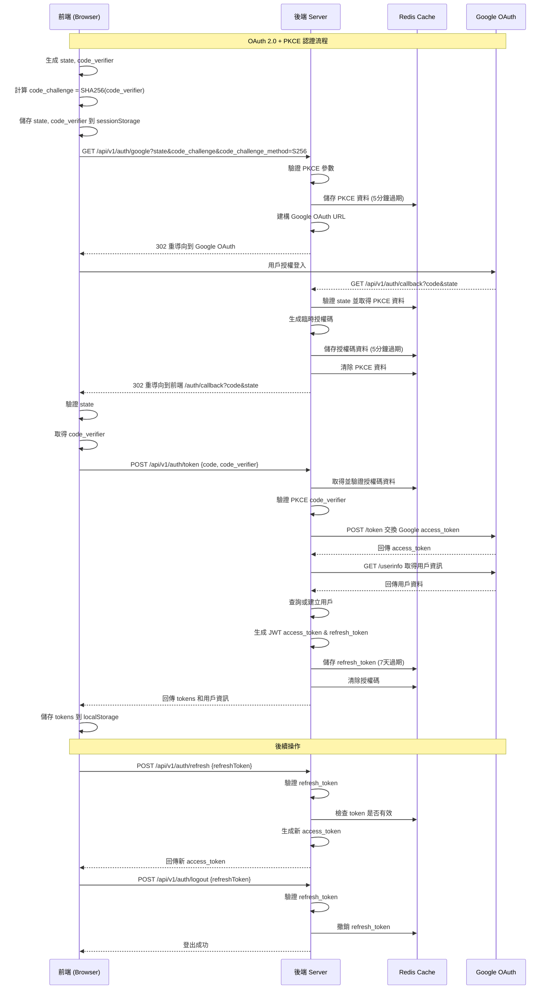

## 前端

```ts=
// 前端發起授權請求
const initiateOAuth = async () => {
  // 生成 state 和 code_verifier
  const state = generateRandomString(32);
  const codeVerifier = generateRandomString(128);
  const codeChallenge = await sha256(codeVerifier);
  
  // 儲存到 sessionStorage
  sessionStorage.setItem('oauth_state', state);
  sessionStorage.setItem('code_verifier', codeVerifier);
  
  // 轉導到後端
  const params = new URLSearchParams({
    state,
    code_challenge: codeChallenge,
    code_challenge_method: 'S256'
  });
  
  window.location.href = `/api/v1/auth/google?${params}`;
};

// 前端處理回調
const handleCallback = async () => {
  const urlParams = new URLSearchParams(window.location.search);
  const code = urlParams.get('code');
  const state = urlParams.get('state');
  const storedState = sessionStorage.getItem('oauth_state');
  const codeVerifier = sessionStorage.getItem('code_verifier');
  
  // 驗證 state
  if (state !== storedState) {
    throw new Error('Invalid state parameter');
  }
  
  // 交換 token
  const response = await fetch('/api/v1/auth/token', {
    method: 'POST',
    headers: { 'Content-Type': 'application/json' },
    body: JSON.stringify({
      code,
      code_verifier: codeVerifier
    })
  });
  
  const { accessToken, refreshToken } = await response.json();
  
  // 安全儲存 token
  localStorage.setItem('access_token', accessToken);
  localStorage.setItem('refresh_token', refreshToken);
};
```

## 後端

```ts
// server.ts
import express from 'express';
import cors from 'cors';
import helmet from 'helmet';
import rateLimit from 'express-rate-limit';
import jwt from 'jsonwebtoken';
import crypto from 'crypto';
import axios from 'axios';
import Redis from 'ioredis';

const app = express();
const redis = new Redis(process.env.REDIS_URL);

// 安全中間件
app.use(helmet());
app.use(cors({
  origin: process.env.FRONTEND_URL,
  credentials: true
}));
app.use(express.json());

// Rate limiting
const authLimiter = rateLimit({
  windowMs: 15 * 60 * 1000, // 15 分鐘
  max: 10, // 限制每 IP 10 次請求
  message: 'Too many authentication attempts'
});

// Google OAuth 設定
const GOOGLE_CONFIG = {
  clientId: process.env.GOOGLE_CLIENT_ID!,
  clientSecret: process.env.GOOGLE_CLIENT_SECRET!,
  redirectUri: process.env.GOOGLE_REDIRECT_URI!,
  scope: 'openid profile email'
};

// 工具函數
const generateRandomString = (length: number): string => {
  return crypto.randomBytes(length).toString('base64url');
};

const sha256 = (plain: string): string => {
  return crypto.createHash('sha256').update(plain).digest('base64url');
};

// 1. 初始 OAuth 請求處理
app.get('/api/v1/auth/google', authLimiter, async (req, res) => {
  try {
    const { state, code_challenge, code_challenge_method } = req.query;
    
    // 驗證必要參數
    if (!state || !code_challenge || code_challenge_method !== 'S256') {
      return res.status(400).json({ 
        error: 'Missing required PKCE parameters' 
      });
    }
    
    // 儲存 PKCE 參數（5分鐘過期）
    const pkceKey = `pkce:${state}`;
    await redis.setex(pkceKey, 300, JSON.stringify({
      codeChallenge: code_challenge,
      timestamp: Date.now()
    }));
    
    // 建構 Google OAuth URL
    const googleAuthUrl = new URL('https://accounts.google.com/o/oauth2/v2/auth');
    googleAuthUrl.searchParams.set('client_id', GOOGLE_CONFIG.clientId);
    googleAuthUrl.searchParams.set('redirect_uri', GOOGLE_CONFIG.redirectUri);
    googleAuthUrl.searchParams.set('response_type', 'code');
    googleAuthUrl.searchParams.set('scope', GOOGLE_CONFIG.scope);
    googleAuthUrl.searchParams.set('state', state as string);
    googleAuthUrl.searchParams.set('access_type', 'offline');
    googleAuthUrl.searchParams.set('prompt', 'consent');
    
    // 重導向到 Google
    res.redirect(googleAuthUrl.toString());
    
  } catch (error) {
    console.error('OAuth initiation error:', error);
    res.redirect(`${process.env.FRONTEND_URL}/auth/error?message=oauth_init_failed`);
  }
});

// 2. Google OAuth 回調處理
app.get('/api/v1/auth/callback', async (req, res) => {
  try {
    const { code, state, error } = req.query;
    
    if (error) {
      console.error('OAuth error:', error);
      return res.redirect(`${process.env.FRONTEND_URL}/auth/error?message=${error}`);
    }
    
    if (!code || !state) {
      return res.redirect(`${process.env.FRONTEND_URL}/auth/error?message=missing_parameters`);
    }
    
    // 驗證 state 並取得 PKCE 資料
    const pkceKey = `pkce:${state}`;
    const pkceData = await redis.get(pkceKey);
    
    if (!pkceData) {
      return res.redirect(`${process.env.FRONTEND_URL}/auth/error?message=invalid_state`);
    }
    
    // 生成臨時授權碼
    const tempAuthCode = generateRandomString(32);
    
    // 儲存授權碼和相關資料
    await redis.setex(`auth_code:${tempAuthCode}`, 300, JSON.stringify({
      googleAuthCode: code,
      state,
      pkceData: JSON.parse(pkceData),
      timestamp: Date.now()
    }));
    
    // 清除 PKCE 資料
    await redis.del(pkceKey);
    
    res.redirect(`${process.env.FRONTEND_URL}/auth/callback?code=${tempAuthCode}&state=${state}`);
    
  } catch (error) {
    console.error('OAuth callback error:', error);
    res.redirect(`${process.env.FRONTEND_URL}/auth/error?message=callback_failed`);
  }
});

// 3. Token 交換端點
app.post('/api/v1/auth/token', authLimiter, async (req, res) => {
  try {
    const { code, code_verifier } = req.body;
    
    if (!code || !code_verifier) {
      return res.status(400).json({ 
        error: 'Missing authorization code or code verifier' 
      });
    }
    
    // 取得授權碼資料
    const authCodeKey = `auth_code:${code}`;
    const authCodeData = await redis.get(authCodeKey);
    
    if (!authCodeData) {
      return res.status(400).json({ 
        error: 'Invalid or expired authorization code' 
      });
    }
    
    const { googleAuthCode, pkceData } = JSON.parse(authCodeData);
    
    // 驗證 PKCE code_verifier
    const computedChallenge = sha256(code_verifier);
    if (computedChallenge !== pkceData.codeChallenge) {
      await redis.del(authCodeKey);
      return res.status(400).json({ 
        error: 'Invalid code verifier' 
      });
    }
    
    // 向 Google 交換 access token
    const tokenResponse = await axios.post('https://oauth2.googleapis.com/token', {
      client_id: GOOGLE_CONFIG.clientId,
      client_secret: GOOGLE_CONFIG.clientSecret,
      code: googleAuthCode,
      grant_type: 'authorization_code',
      redirect_uri: GOOGLE_CONFIG.redirectUri
    });
    
    const { access_token } = tokenResponse.data;
    
    // 取得用戶資訊
    const userResponse = await axios.get('https://www.googleapis.com/oauth2/v2/userinfo', {
      headers: { Authorization: `Bearer ${access_token}` }
    });
    
    const googleUser = userResponse.data;
    
    // 查詢或建立用戶（這裡需要根據你的資料庫實作）
    const user = await findOrCreateUser({
      googleId: googleUser.id,
      email: googleUser.email,
      name: googleUser.name,
      picture: googleUser.picture
    });
    
    // 生成 JWT tokens
    const accessToken = jwt.sign(
      { 
        sub: user.id,
        email: user.email,
        name: user.name,
        roleId: user.roleId 
      },
      process.env.JWT_SECRET!,
      { 
        expiresIn: '15m',
        algorithm: 'HS256',
        issuer: 'your-app',
        audience: 'your-frontend'
      }
    );
    
    const refreshToken = jwt.sign(
      { 
        sub: user.id,
        type: 'refresh' 
      },
      process.env.JWT_SECRET!,
      { 
        expiresIn: '7d',
        algorithm: 'HS256'
      }
    );
    
    // 儲存 refresh token（可選，用於撤銷）
    await redis.setex(`refresh_token:${user.id}`, 7 * 24 * 60 * 60, refreshToken);
    
    // 清除授權碼
    await redis.del(authCodeKey);
    
    // 回傳 tokens
    res.json({
      accessToken,
      refreshToken,
      user: {
        id: user.id,
        name: user.name,
        email: user.email,
        roleId: user.roleId
      }
    });
    
  } catch (error) {
    console.error('Token exchange error:', error);
    res.status(500).json({ 
      error: 'Token exchange failed' 
    });
  }
});

// 4. Refresh token 端點
app.post('/api/v1/auth/refresh', async (req, res) => {
  try {
    const { refreshToken } = req.body;
    
    if (!refreshToken) {
      return res.status(400).json({ error: 'Missing refresh token' });
    }
    
    // 驗證 refresh token
    const decoded = jwt.verify(refreshToken, process.env.JWT_SECRET!) as any;
    
    if (decoded.type !== 'refresh') {
      return res.status(400).json({ error: 'Invalid token type' });
    }
    
    // 檢查 token 是否在 Redis 中（未被撤銷）
    const storedToken = await redis.get(`refresh_token:${decoded.sub}`);
    if (storedToken !== refreshToken) {
      return res.status(401).json({ error: 'Token revoked or invalid' });
    }
    
    // 取得用戶資訊
    const user = await getUserById(decoded.sub);
    if (!user) {
      return res.status(404).json({ error: 'User not found' });
    }
    
    // 生成新的 access token
    const newAccessToken = jwt.sign(
      { 
        sub: user.id,
        email: user.email,
        name: user.name,
        roleId: user.roleId 
      },
      process.env.JWT_SECRET!,
      { 
        expiresIn: '15m',
        algorithm: 'HS256'
      }
    );
    
    res.json({ accessToken: newAccessToken });
    
  } catch (error) {
    console.error('Token refresh error:', error);
    res.status(401).json({ error: 'Invalid refresh token' });
  }
});

// 5. 登出端點
app.post('/api/v1/auth/logout', async (req, res) => {
  try {
    const { refreshToken } = req.body;
    
    if (refreshToken) {
      const decoded = jwt.verify(refreshToken, process.env.JWT_SECRET!) as any;
      // 撤銷 refresh token
      await redis.del(`refresh_token:${decoded.sub}`);
    }
    
    res.json({ message: 'Logged out successfully' });
    
  } catch (error) {
    res.json({ message: 'Logged out successfully' });
  }
});

```